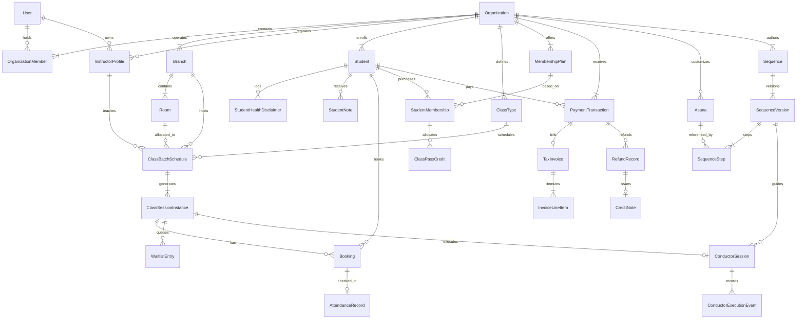

# YogaOS — Database Architecture & Logical Data Model

**Document Reference:** `docs/architecture/DATABASE_ARCHITECTURE.md`  
**Version:** 1.0.0 (Database Architecture Baseline — Phase P04)  
**Status:** Approved for Implementation Planning  
**Role:** Principal Database Architect & Senior Data Solutions Engineer  

---

## 1. Logical Data Modeling Principles

### 1.1 Core Relational Foundations
YogaOS relies on **PostgreSQL 16** as its canonical relational data store. The data architecture is structured according to strict relational engineering principles:

1. **UUID Primary Keys:** All tables use **UUIDv7** (time-sortable 128-bit identifiers) or UUIDv4 as primary keys. Time-sortable UUIDs avoid B-Tree index fragmentation common to random UUIDs while preventing enumeration attacks.
2. **Strict Multi-Tenant Scoping (`tenant_id`):** Every tenant-owned table features a non-nullable `tenant_id` foreign key referencing `organizations(id)`. This key is the foundational predicate for query filtering, composite indexing, and Row-Level Security (RLS).
3. **Decoupled Student Identity:** A student record (`Student`) is identified internally by an immutable UUID (`id`). Phone numbers and email addresses are mutable contact identifiers stored in dedicated fields, allowing students to update their carrier or contact info without corrupting attendance, historical billing, or pass credits.
4. **Immutability of Financial & Execution Records:** Invoices, credit notes, payment receipts, and class execution event logs are **immutable**. Once written, they cannot be updated or destroyed in place; adjustments are made via offsetting credit notes or reverse entries.
5. **Soft Deletion vs Physical Retention:** Master entities (Students, Staff, Class Types, Membership Plans) use soft deletion (`deleted_at TIMESTAMP WITH TIME ZONE NULL`) to preserve historical relational integrity for past class logs and invoices. Temporary or ephemeral records (e.g., active session locks, cache keys) use physical deletion or TTL eviction.
6. **Encrypted Personal Health Data:** Student health injury narratives are stored as ciphertext with an initialization vector (`health_notes_ciphertext`, `health_notes_iv`) to comply with India's DPDP Act 2023.

---

## 2. High-Level Entity-Relationship Model

---

## 3. Detailed Entity Schema Specifications

### 3.1 Identity, Authentication & Multi-Tenancy

#### `users`
Global platform user identity. A human user (owner, manager, teacher, receptionist) exists once globally.
* `id`: `UUID` (PK)
* `email`: `VARCHAR(255)` (UNIQUE, NOT NULL)
* `phone`: `VARCHAR(32)` (NULLABLE, indexed)
* `password_hash`: `VARCHAR(255)` (NOT NULL)
* `full_name`: `VARCHAR(150)` (NOT NULL)
* `avatar_url`: `VARCHAR(512)` (NULLABLE)
* `is_platform_admin`: `BOOLEAN` (DEFAULT FALSE)
* `created_at`: `TIMESTAMPTZ` (DEFAULT NOW())
* `updated_at`: `TIMESTAMPTZ` (DEFAULT NOW())
* **Indexes:** `idx_users_email` (UNIQUE), `idx_users_phone`

#### `organizations`
The root tenant boundary for each yoga studio business.
* `id`: `UUID` (PK)
* `slug`: `VARCHAR(100)` (UNIQUE, NOT NULL)
* `name`: `VARCHAR(200)` (NOT NULL)
* `legal_entity_name`: `VARCHAR(255)` (NOT NULL)
* `currency`: `VARCHAR(3)` (DEFAULT 'INR', NOT NULL)
* `timezone`: `VARCHAR(64)` (DEFAULT 'Asia/Kolkata', NOT NULL)
* `is_gst_registered`: `BOOLEAN` (DEFAULT FALSE, NOT NULL)
* `gstin`: `VARCHAR(15)` (NULLABLE)
* `pan_number`: `VARCHAR(10)` (NULLABLE)
* `billing_address`: `JSONB` (NOT NULL)
* `created_at`: `TIMESTAMPTZ` (DEFAULT NOW())
* `updated_at`: `TIMESTAMPTZ` (DEFAULT NOW())
* `deleted_at`: `TIMESTAMPTZ` (NULLABLE)
* **Indexes:** `idx_org_slug` (UNIQUE), `idx_org_gstin`

#### `organization_members`
Association linking a global `User` to a tenant `Organization` with specific roles and scopes.
* `id`: `UUID` (PK)
* `tenant_id`: `UUID` (FK -> `organizations.id`, NOT NULL)
* `user_id`: `UUID` (FK -> `users.id`, NOT NULL)
* `role`: `VARCHAR(32)` (ENUM: `OWNER`, `MANAGER`, `INSTRUCTOR`, `RECEPTIONIST`, NOT NULL)
* `status`: `VARCHAR(32)` (ENUM: `INVITED`, `ACTIVE`, `SUSPENDED`, NOT NULL)
* `branch_scope`: `JSONB` (NULLABLE; array of branch UUIDs or NULL for all branches)
* `created_at`: `TIMESTAMPTZ` (DEFAULT NOW())
* `updated_at`: `TIMESTAMPTZ` (DEFAULT NOW())
* **Constraints:** `UNIQUE(tenant_id, user_id)`
* **Indexes:** `idx_org_members_user` (`user_id`), `idx_org_members_tenant` (`tenant_id`, `role`)

#### `branches`
Physical or virtual studio locations operated by an organization.
* `id`: `UUID` (PK)
* `tenant_id`: `UUID` (FK -> `organizations.id`, NOT NULL)
* `name`: `VARCHAR(150)` (NOT NULL)
* `slug`: `VARCHAR(100)` (NOT NULL)
* `street_address`: `TEXT` (NOT NULL)
* `city`: `VARCHAR(100)` (NOT NULL)
* `state`: `VARCHAR(100)` (NOT NULL)
* `state_code`: `VARCHAR(2)` (NOT NULL; Indian 2-digit GST state code, e.g. '29' for KA)
* `postal_code`: `VARCHAR(16)` (NOT NULL)
* `phone`: `VARCHAR(32)` (NOT NULL)
* `email`: `VARCHAR(255)` (NOT NULL)
* `operating_hours`: `JSONB` (NULLABLE)
* `created_at`: `TIMESTAMPTZ` (DEFAULT NOW())
* `updated_at`: `TIMESTAMPTZ` (DEFAULT NOW())
* `deleted_at`: `TIMESTAMPTZ` (NULLABLE)
* **Constraints:** `UNIQUE(tenant_id, slug)`
* **Indexes:** `idx_branches_tenant` (`tenant_id`, `state_code`)

#### `rooms`
Practice halls or yoga shalas within a physical branch.
* `id`: `UUID` (PK)
* `tenant_id`: `UUID` (FK -> `organizations.id`, NOT NULL)
* `branch_id`: `UUID` (FK -> `branches.id`, NOT NULL)
* `name`: `VARCHAR(100)` (NOT NULL)
* `max_mat_capacity`: `INTEGER` (NOT NULL)
* `is_active`: `BOOLEAN` (DEFAULT TRUE, NOT NULL)
* `created_at`: `TIMESTAMPTZ` (DEFAULT NOW())
* **Indexes:** `idx_rooms_branch` (`tenant_id`, `branch_id`)

---

### 3.2 Staff & Instructors

#### `instructor_profiles`
Teacher profile and teaching parameters linked to an organization membership.
* `id`: `UUID` (PK)
* `tenant_id`: `UUID` (FK -> `organizations.id`, NOT NULL)
* `user_id`: `UUID` (FK -> `users.id`, NOT NULL)
* `display_name`: `VARCHAR(150)` (NOT NULL)
* `bio`: `TEXT` (NULLABLE)
* `certifications`: `TEXT[]` (DEFAULT '{}')
* `teaching_styles`: `TEXT[]` (DEFAULT '{}')
* `hourly_rate`: `NUMERIC(10, 2)` (NULLABLE)
* `is_active`: `BOOLEAN` (DEFAULT TRUE, NOT NULL)
* `created_at`: `TIMESTAMPTZ` (DEFAULT NOW())
* **Constraints:** `UNIQUE(tenant_id, user_id)`
* **Indexes:** `idx_instructor_tenant_user` (`tenant_id`, `user_id`)

---

### 3.3 Student Management & Privacy CRM

#### `students`
Student master profile. Anchored to internal immutable `id` (UUID). Phone/email are mutable contact fields.
* `id`: `UUID` (PK)
* `tenant_id`: `UUID` (FK -> `organizations.id`, NOT NULL)
* `home_branch_id`: `UUID` (FK -> `branches.id`, NOT NULL)
* `full_name`: `VARCHAR(150)` (NOT NULL)
* `mobile_phone`: `VARCHAR(32)` (NOT NULL)
* `email`: `VARCHAR(255)` (NULLABLE)
* `date_of_birth`: `DATE` (NULLABLE)
* `gender`: `VARCHAR(32)` (NULLABLE)
* `emergency_contact_name`: `VARCHAR(150)` (NOT NULL)
* `emergency_contact_phone`: `VARCHAR(32)` (NOT NULL)
* `emergency_contact_relation`: `VARCHAR(64)` (NOT NULL)
* `status`: `VARCHAR(32)` (ENUM: `LEAD`, `TRIAL`, `ACTIVE`, `INACTIVE`, `CHURNED`, DEFAULT 'LEAD')
* `billing_address`: `JSONB` (NULLABLE)
* `billing_state_code`: `VARCHAR(2)` (NULLABLE; used for GST state matching)
* `has_health_alert`: `BOOLEAN` (DEFAULT FALSE, NOT NULL; non-clinical front-desk flag)
* `created_at`: `TIMESTAMPTZ` (DEFAULT NOW())
* `updated_at`: `TIMESTAMPTZ` (DEFAULT NOW())
* `deleted_at`: `TIMESTAMPTZ` (NULLABLE)
* **Indexes:** `idx_students_tenant_phone` (`tenant_id`, `mobile_phone`), `idx_students_tenant_name` (`tenant_id`, `full_name`), `idx_students_status` (`tenant_id`, `status`)

#### `student_health_disclaimers`
Encrypted health, injury, and physical limitation narratives. Visible only to assigned instructors & management.
* `id`: `UUID` (PK)
* `tenant_id`: `UUID` (FK -> `organizations.id`, NOT NULL)
* `student_id`: `UUID` (FK -> `students.id`, NOT NULL)
* `injury_summary`: `VARCHAR(255)` (NULLABLE; e.g. "Lower Back L4/L5, Right Wrist")
* `health_notes_ciphertext`: `TEXT` (NOT NULL; AES-256-GCM encrypted detailed narrative)
* `health_notes_iv`: `VARCHAR(64)` (NOT NULL)
* `has_pregnancy_alert`: `BOOLEAN` (DEFAULT FALSE, NOT NULL)
* `consent_signed`: `BOOLEAN` (DEFAULT TRUE, NOT NULL)
* `consent_timestamp`: `TIMESTAMPTZ` (NOT NULL)
* `consent_ip_address`: `VARCHAR(64)` (NULLABLE)
* `updated_by_user_id`: `UUID` (FK -> `users.id`, NOT NULL)
* `updated_at`: `TIMESTAMPTZ` (DEFAULT NOW())
* **Constraints:** `UNIQUE(tenant_id, student_id)`
* **Indexes:** `idx_student_health_student` (`tenant_id`, `student_id`)

---

### 3.4 Classes, Scheduling & Batches

#### `class_types`
Reusable class format definitions.
* `id`: `UUID` (PK)
* `tenant_id`: `UUID` (FK -> `organizations.id`, NOT NULL)
* `title`: `VARCHAR(150)` (NOT NULL)
* `description`: `TEXT` (NULLABLE)
* `style`: `VARCHAR(64)` (e.g. 'Hatha', 'Vinyasa', 'Ashtanga', 'Pranayama')
* `level`: `VARCHAR(32)` (ENUM: `ALL_LEVELS`, `BEGINNER`, `INTERMEDIATE`, `ADVANCED`)
* `default_duration_mins`: `INTEGER` (DEFAULT 60, NOT NULL)
* `default_capacity`: `INTEGER` (DEFAULT 20, NOT NULL)
* `is_active`: `BOOLEAN` (DEFAULT TRUE, NOT NULL)
* `created_at`: `TIMESTAMPTZ` (DEFAULT NOW())
* **Indexes:** `idx_class_types_tenant` (`tenant_id`, `title`)

#### `class_batch_schedules`
Recurring weekly timetable rules or one-time batch definitions.
* `id`: `UUID` (PK)
* `tenant_id`: `UUID` (FK -> `organizations.id`, NOT NULL)
* `class_type_id`: `UUID` (FK -> `class_types.id`, NOT NULL)
* `branch_id`: `UUID` (FK -> `branches.id`, NOT NULL)
* `room_id`: `UUID` (FK -> `rooms.id`, NOT NULL)
* `instructor_profile_id`: `UUID` (FK -> `instructor_profiles.id`, NOT NULL)
* `schedule_type`: `VARCHAR(32)` (ENUM: `RECURRING_WEEKLY`, `ONE_TIME_WORKSHOP`)
* `days_of_week`: `INTEGER[]` (e.g. `{1, 3, 5}` for Mon/Wed/Fri; 0=Sun)
* `start_time`: `TIME` (NOT NULL; local branch time)
* `end_time`: `TIME` (NOT NULL; local branch time)
* `effective_from`: `DATE` (NOT NULL)
* `effective_to`: `DATE` (NULLABLE)
* `capacity_override`: `INTEGER` (NULLABLE)
* `created_at`: `TIMESTAMPTZ` (DEFAULT NOW())
* **Indexes:** `idx_batch_sched_tenant_branch` (`tenant_id`, `branch_id`), `idx_batch_sched_instructor` (`tenant_id`, `instructor_profile_id`)

#### `class_session_instances`
Calendar instances of classes generated from recurring batch rules or single events.
* `id`: `UUID` (PK)
* `tenant_id`: `UUID` (FK -> `organizations.id`, NOT NULL)
* `batch_schedule_id`: `UUID` (FK -> `class_batch_schedules.id`, NULLABLE)
* `class_type_id`: `UUID` (FK -> `class_types.id`, NOT NULL)
* `branch_id`: `UUID` (FK -> `branches.id`, NOT NULL)
* `room_id`: `UUID` (FK -> `rooms.id`, NOT NULL)
* `instructor_profile_id`: `UUID` (FK -> `instructor_profiles.id`, NOT NULL)
* `attached_sequence_version_id`: `UUID` (NULLABLE; FK to `sequence_versions.id`)
* `session_date`: `DATE` (NOT NULL)
* `start_timestamp`: `TIMESTAMPTZ` (NOT NULL)
* `end_timestamp`: `TIMESTAMPTZ` (NOT NULL)
* `max_capacity`: `INTEGER` (NOT NULL)
* `status`: `VARCHAR(32)` (ENUM: `SCHEDULED`, `IN_PROGRESS`, `COMPLETED`, `CANCELLED`, DEFAULT 'SCHEDULED')
* `cancellation_reason`: `VARCHAR(255)` (NULLABLE)
* `created_at`: `TIMESTAMPTZ` (DEFAULT NOW())
* **Indexes:** `idx_session_tenant_date` (`tenant_id`, `session_date`), `idx_session_instructor` (`tenant_id`, `instructor_profile_id`, `start_timestamp`), `idx_session_room` (`tenant_id`, `room_id`, `start_timestamp`)

---

### 3.5 Bookings, Waitlists & Attendance

#### `bookings`
Student reservations for a specific class session instance.
* `id`: `UUID` (PK)
* `tenant_id`: `UUID` (FK -> `organizations.id`, NOT NULL)
* `session_instance_id`: `UUID` (FK -> `class_session_instances.id`, NOT NULL)
* `student_id`: `UUID` (FK -> `students.id`, NOT NULL)
* `student_membership_id`: `UUID` (NULLABLE; FK to `student_memberships.id`)
* `status`: `VARCHAR(32)` (ENUM: `BOOKED`, `ATTENDED`, `LATE_CANCEL`, `NO_SHOW`, DEFAULT 'BOOKED')
* `booked_at`: `TIMESTAMPTZ` (DEFAULT NOW(), NOT NULL)
* `cancelled_at`: `TIMESTAMPTZ` (NULLABLE)
* `is_pass_credit_deducted`: `BOOLEAN` (DEFAULT FALSE, NOT NULL)
* **Constraints:** `UNIQUE(tenant_id, session_instance_id, student_id)`
* **Indexes:** `idx_bookings_session` (`tenant_id`, `session_instance_id`, `status`), `idx_bookings_student` (`tenant_id`, `student_id`)

#### `waitlist_entries`
FIFO waitlist queue for fully booked sessions.
* `id`: `UUID` (PK)
* `tenant_id`: `UUID` (FK -> `organizations.id`, NOT NULL)
* `session_instance_id`: `UUID` (FK -> `class_session_instances.id`, NOT NULL)
* `student_id`: `UUID` (FK -> `students.id`, NOT NULL)
* `priority_rank`: `INTEGER` (NOT NULL)
* `status`: `VARCHAR(32)` (ENUM: `WAITING`, `PROMOTED`, `EXPIRED`, `CANCELLED`, DEFAULT 'WAITING')
* `promoted_to_booking_id`: `UUID` (NULLABLE; FK to `bookings.id`)
* `created_at`: `TIMESTAMPTZ` (DEFAULT NOW())
* **Constraints:** `UNIQUE(tenant_id, session_instance_id, priority_rank)`
* **Indexes:** `idx_waitlist_session_rank` (`tenant_id`, `session_instance_id`, `status`, `priority_rank`)

#### `attendance_records`
Immutable check-in execution log.
* `id`: `UUID` (PK)
* `tenant_id`: `UUID` (FK -> `organizations.id`, NOT NULL)
* `booking_id`: `UUID` (FK -> `bookings.id`, UNIQUE, NOT NULL)
* `checked_in_at`: `TIMESTAMPTZ` (DEFAULT NOW(), NOT NULL)
* `checked_in_by_user_id`: `UUID` (FK -> `users.id`, NOT NULL)
* `check_in_method`: `VARCHAR(32)` (ENUM: `FRONT_DESK_ROSTER`, `KIOSK`, `MANUAL_OVERRIDE`)
* **Indexes:** `idx_attendance_tenant_time` (`tenant_id`, `checked_in_at`)

---

### 3.6 Memberships & Passes

#### `membership_plans`
Productized membership offerings.
* `id`: `UUID` (PK)
* `tenant_id`: `UUID` (FK -> `organizations.id`, NOT NULL)
* `name`: `VARCHAR(150)` (NOT NULL)
* `plan_type`: `VARCHAR(32)` (ENUM: `TIME_UNLIMITED`, `CLASS_PACK`, `SINGLE_DROP_IN`, NOT NULL)
* `price`: `NUMERIC(10, 2)` (NOT NULL)
* `tax_rate_percent`: `NUMERIC(5, 2)` (DEFAULT 18.00, NOT NULL)
* `sac_code`: `VARCHAR(16)` (DEFAULT '9992', NOT NULL)
* `validity_days`: `INTEGER` (NOT NULL)
* `credit_count`: `INTEGER` (NULLABLE; e.g. 10 for 10-Class Pack)
* `max_freezes_allowed`: `INTEGER` (DEFAULT 0, NOT NULL)
* `max_freeze_days`: `INTEGER` (DEFAULT 0, NOT NULL)
* `is_multi_branch_valid`: `BOOLEAN` (DEFAULT TRUE, NOT NULL)
* `is_active`: `BOOLEAN` (DEFAULT TRUE, NOT NULL)
* `created_at`: `TIMESTAMPTZ` (DEFAULT NOW())
* **Indexes:** `idx_membership_plans_tenant` (`tenant_id`, `is_active`)

#### `student_memberships`
Active or historical membership purchased by a student.
* `id`: `UUID` (PK)
* `tenant_id`: `UUID` (FK -> `organizations.id`, NOT NULL)
* `student_id`: `UUID` (FK -> `students.id`, NOT NULL)
* `membership_plan_id`: `UUID` (FK -> `membership_plans.id`, NOT NULL)
* `status`: `VARCHAR(32)` (ENUM: `ACTIVE`, `FROZEN`, `EXPIRED`, `CANCELLED`, DEFAULT 'ACTIVE')
* `start_date`: `DATE` (NOT NULL)
* `expiry_date`: `DATE` (NOT NULL)
* `total_credits`: `INTEGER` (NULLABLE)
* `remaining_credits`: `INTEGER` (NULLABLE)
* `frozen_at`: `TIMESTAMPTZ` (NULLABLE)
* `freeze_unfreeze_date`: `DATE` (NULLABLE)
* `total_frozen_days`: `INTEGER` (DEFAULT 0, NOT NULL)
* `created_at`: `TIMESTAMPTZ` (DEFAULT NOW())
* **Indexes:** `idx_student_mem_tenant_student` (`tenant_id`, `student_id`, `status`), `idx_student_mem_expiry` (`tenant_id`, `expiry_date`, `status`)

---

### 3.7 Billing, Invoicing & Configurable GST

#### `payment_transactions`
Payment records across all channels.
* `id`: `UUID` (PK)
* `tenant_id`: `UUID` (FK -> `organizations.id`, NOT NULL)
* `student_id`: `UUID` (FK -> `students.id`, NOT NULL)
* `student_membership_id`: `UUID` (NULLABLE; FK to `student_memberships.id`)
* `amount`: `NUMERIC(10, 2)` (NOT NULL)
* `currency`: `VARCHAR(3)` (DEFAULT 'INR', NOT NULL)
* `payment_mode`: `VARCHAR(32)` (ENUM: `UPI`, `CREDIT_CARD`, `DEBIT_CARD`, `NET_BANKING`, `CASH`, `BANK_TRANSFER`, NOT NULL)
* `utr_reference_number`: `VARCHAR(100)` (NULLABLE; UPI transaction ID or Bank UTR)
* `status`: `VARCHAR(32)` (ENUM: `COMPLETED`, `REFUNDED`, `PARTIALLY_REFUNDED`, `FAILED`, DEFAULT 'COMPLETED')
* `paid_at`: `TIMESTAMPTZ` (DEFAULT NOW(), NOT NULL)
* `recorded_by_user_id`: `UUID` (FK -> `users.id`, NOT NULL)
* **Indexes:** `idx_payments_tenant_date` (`tenant_id`, `paid_at`), `idx_payments_utr` (`tenant_id`, `utr_reference_number`)

#### `tax_invoices`
Immutable, sequential GST tax invoices.
* `id`: `UUID` (PK)
* `tenant_id`: `UUID` (FK -> `organizations.id`, NOT NULL)
* `branch_id`: `UUID` (FK -> `branches.id`, NOT NULL)
* `payment_transaction_id`: `UUID` (FK -> `payment_transactions.id`, UNIQUE, NOT NULL)
* `invoice_number`: `VARCHAR(64)` (NOT NULL; sequential per branch financial year)
* `fiscal_year`: `VARCHAR(10)` (NOT NULL; e.g. '2026-27')
* `supplier_gstin`: `VARCHAR(15)` (NULLABLE)
* `supplier_legal_name`: `VARCHAR(255)` (NOT NULL)
* `supplier_state_code`: `VARCHAR(2)` (NOT NULL)
* `customer_name`: `VARCHAR(150)` (NOT NULL)
* `customer_state_code`: `VARCHAR(2)` (NOT NULL)
* `taxable_amount`: `NUMERIC(10, 2)` (NOT NULL)
* `cgst_rate_percent`: `NUMERIC(5, 2)` (DEFAULT 0.00, NOT NULL)
* `cgst_amount`: `NUMERIC(10, 2)` (DEFAULT 0.00, NOT NULL)
* `sgst_rate_percent`: `NUMERIC(5, 2)` (DEFAULT 0.00, NOT NULL)
* `sgst_amount`: `NUMERIC(10, 2)` (DEFAULT 0.00, NOT NULL)
* `igst_rate_percent`: `NUMERIC(5, 2)` (DEFAULT 0.00, NOT NULL)
* `igst_amount`: `NUMERIC(10, 2)` (DEFAULT 0.00, NOT NULL)
* `total_invoice_amount`: `NUMERIC(10, 2)` (NOT NULL)
* `pdf_s3_key`: `VARCHAR(512)` (NULLABLE)
* `issued_at`: `TIMESTAMPTZ` (DEFAULT NOW(), NOT NULL)
* **Constraints:** `UNIQUE(tenant_id, branch_id, fiscal_year, invoice_number)`
* **Indexes:** `idx_invoices_tenant_fiscal` (`tenant_id`, `fiscal_year`, `invoice_number`)

---

### 3.8 Asanas, Sequences & Automated Class Conductor

#### `asanas`
Classical posture taxonomy and studio-specific custom postures.
* `id`: `UUID` (PK)
* `tenant_id`: `UUID` (NULLABLE; NULL for global platform library, UUID for studio custom asanas)
* `sanskrit_name`: `VARCHAR(150)` (NOT NULL)
* `sanskrit_name_iast`: `VARCHAR(150)` (NOT NULL; e.g. 'Adho Mukha Śvānāsana')
* `english_name`: `VARCHAR(150)` (NOT NULL; e.g. 'Downward-Facing Dog')
* `category`: `VARCHAR(64)` (ENUM: `STANDING`, `SEATED`, `INVERSION`, `BACKBEND`, `FORWARD_BEND`, `ARM_BALANCE`, `RESTORATIVE`, `PRANAYAMA`, NOT NULL)
* `difficulty`: `VARCHAR(32)` (ENUM: `BEGINNER`, `INTERMEDIATE`, `ADVANCED`, NOT NULL)
* `anatomical_focus`: `TEXT[]` (DEFAULT '{}')
* `contraindications`: `TEXT` (NULLABLE)
* `alignment_cues`: `TEXT` (NULLABLE)
* `default_image_media_id`: `UUID` (NULLABLE; FK to `media_assets.id`)
* `created_at`: `TIMESTAMPTZ` (DEFAULT NOW())
* **Indexes:** `idx_asanas_search` (`sanskrit_name`, `english_name`, `category`)

#### `sequences`
Master sequence record container.
* `id`: `UUID` (PK)
* `tenant_id`: `UUID` (FK -> `organizations.id`, NOT NULL)
* `creator_user_id`: `UUID` (FK -> `users.id`, NOT NULL)
* `title`: `VARCHAR(200)` (NOT NULL)
* `description`: `TEXT` (NULLABLE)
* `target_level`: `VARCHAR(32)` (ENUM: `BEGINNER`, `INTERMEDIATE`, `ADVANCED`, `ALL_LEVELS`)
* `is_studio_template`: `BOOLEAN` (DEFAULT FALSE, NOT NULL)
* `active_version`: `INTEGER` (DEFAULT 1, NOT NULL)
* `created_at`: `TIMESTAMPTZ` (DEFAULT NOW())
* `updated_at`: `TIMESTAMPTZ` (DEFAULT NOW())
* **Indexes:** `idx_sequences_tenant` (`tenant_id`, `title`)

#### `sequence_versions`
Immutable versioned snapshot of an asana sequence.
* `id`: `UUID` (PK)
* `tenant_id`: `UUID` (FK -> `organizations.id`, NOT NULL)
* `sequence_id`: `UUID` (FK -> `sequences.id`, NOT NULL)
* `version_number`: `INTEGER` (NOT NULL)
* `status`: `VARCHAR(32)` (ENUM: `DRAFT`, `PUBLISHED`, `ARCHIVED`, DEFAULT 'DRAFT')
* `total_estimated_duration_secs`: `INTEGER` (NOT NULL)
* `media_manifest`: `JSONB` (NULLABLE; precomputed list of URLs and SHA-256 hashes for offline download)
* `published_at`: `TIMESTAMPTZ` (NULLABLE)
* `created_at`: `TIMESTAMPTZ` (DEFAULT NOW())
* **Constraints:** `UNIQUE(tenant_id, sequence_id, version_number)`
* **Indexes:** `idx_seq_versions_seq` (`tenant_id`, `sequence_id`, `status`)

#### `sequence_steps`
Linear ordered steps comprising a sequence version.
* `id`: `UUID` (PK)
* `tenant_id`: `UUID` (FK -> `organizations.id`, NOT NULL)
* `sequence_version_id`: `UUID` (FK -> `sequence_versions.id`, NOT NULL)
* `step_order`: `INTEGER` (NOT NULL)
* `asana_id`: `UUID` (FK -> `asanas.id`, NOT NULL)
* `execution_mode`: `VARCHAR(32)` (ENUM: `TIME_HOLD`, `BREATH_COUNT`, `REPETITION`, DEFAULT 'TIME_HOLD')
* `duration_seconds`: `INTEGER` (NOT NULL)
* `is_bilateral`: `BOOLEAN` (DEFAULT FALSE, NOT NULL)
* `side`: `VARCHAR(16)` (ENUM: `NONE`, `RIGHT`, `LEFT`, DEFAULT 'NONE')
* `rest_interval_seconds`: `INTEGER` (DEFAULT 0, NOT NULL)
* `voice_audio_media_id`: `UUID` (NULLABLE; FK to `media_assets.id`)
* `demo_video_media_id`: `UUID` (NULLABLE; FK to `media_assets.id`)
* `reference_image_media_id`: `UUID` (NULLABLE; FK to `media_assets.id`)
* `transition_notes`: `TEXT` (NULLABLE)
* **Constraints:** `UNIQUE(tenant_id, sequence_version_id, step_order)`
* **Indexes:** `idx_seq_steps_version` (`sequence_version_id`, `step_order`)

#### `conductor_sessions`
Live or completed class conductor execution instance.
* `id`: `UUID` (PK)
* `tenant_id`: `UUID` (FK -> `organizations.id`, NOT NULL)
* `session_instance_id`: `UUID` (FK -> `class_session_instances.id`, UNIQUE, NOT NULL)
* `sequence_version_id`: `UUID` (FK -> `sequence_versions.id`, NOT NULL)
* `conductor_instructor_id`: `UUID` (FK -> `instructor_profiles.id`, NOT NULL)
* `status`: `VARCHAR(32)` (ENUM: `PREPARING`, `RUNNING`, `PAUSED`, `COMPLETED`, `INTERRUPTED_ABANDONED`, `ABORTED_EARLY`)
* `actual_started_at`: `TIMESTAMPTZ` (NULLABLE)
* `actual_concluded_at`: `TIMESTAMPTZ` (NULLABLE)
* `total_elapsed_seconds`: `INTEGER` (DEFAULT 0, NOT NULL)
* `completed_steps_count`: `INTEGER` (DEFAULT 0, NOT NULL)
* `skipped_steps_count`: `INTEGER` (DEFAULT 0, NOT NULL)
* `added_time_seconds`: `INTEGER` (DEFAULT 0, NOT NULL)
* `client_session_uuid`: `UUID` (NOT NULL; client-generated idempotency key)
* `created_at`: `TIMESTAMPTZ` (DEFAULT NOW())
* `updated_at`: `TIMESTAMPTZ` (DEFAULT NOW())
* **Indexes:** `idx_conductor_sessions_tenant` (`tenant_id`, `status`)

#### `conductor_execution_events`
Audit event stream synchronized from offline/online conductor execution.
* `id`: `UUID` (PK)
* `tenant_id`: `UUID` (FK -> `organizations.id`, NOT NULL)
* `conductor_session_id`: `UUID` (FK -> `conductor_sessions.id`, NOT NULL)
* `client_event_uuid`: `UUID` (UNIQUE, NOT NULL; client idempotency key)
* `event_type`: `VARCHAR(64)` (ENUM: `SESSION_STARTED`, `STEP_STARTED`, `STEP_COMPLETED`, `STEP_SKIPPED`, `TIME_ADDED`, `SESSION_PAUSED`, `SESSION_RESUMED`, `SESSION_CONCLUDED`)
* `step_order`: `INTEGER` (NULLABLE)
* `client_timestamp`: `TIMESTAMPTZ` (NOT NULL)
* `server_received_at`: `TIMESTAMPTZ` (DEFAULT NOW(), NOT NULL)
* `payload`: `JSONB` (NULLABLE)
* **Constraints:** `UNIQUE(conductor_session_id, client_event_uuid)`
* **Indexes:** `idx_conductor_events_session` (`conductor_session_id`, `client_timestamp`)

---

### 3.9 Media Assets & Audit Logs

#### `media_assets`
Metadata records for all teacher-uploaded media in private S3 buckets.
* `id`: `UUID` (PK)
* `tenant_id`: `UUID` (FK -> `organizations.id`, NOT NULL)
* `uploaded_by_user_id`: `UUID` (FK -> `users.id`, NOT NULL)
* `media_type`: `VARCHAR(32)` (ENUM: `AUDIO_CUE`, `DEMO_VIDEO`, `ALIGNMENT_IMAGE`, `WAIVER_DOCUMENT`, NOT NULL)
* `file_name`: `VARCHAR(255)` (NOT NULL)
* `mime_type`: `VARCHAR(100)` (NOT NULL)
* `file_size_bytes`: `BIGINT` (NOT NULL)
* `s3_bucket`: `VARCHAR(100)` (NOT NULL)
* `s3_key`: `VARCHAR(512)` (NOT NULL)
* `sha256_hash`: `VARCHAR(64)` (NOT NULL; used for offline integrity verification)
* `video_stream_uid`: `VARCHAR(100)` (NULLABLE; Cloudflare Stream / Mux asset ID)
* `is_verified`: `BOOLEAN` (DEFAULT FALSE, NOT NULL)
* `created_at`: `TIMESTAMPTZ` (DEFAULT NOW())
* **Indexes:** `idx_media_tenant` (`tenant_id`, `media_type`)

#### `audit_logs`
Immutable compliance audit trail for security and sensitive data access.
* `id`: `UUID` (PK)
* `tenant_id`: `UUID` (FK -> `organizations.id`, NOT NULL)
* `user_id`: `UUID` (NULLABLE; FK to `users.id`)
* `action`: `VARCHAR(100)` (NOT NULL; e.g. `HEALTH_DATA_VIEWED`, `INVOICE_GENERATED`, `MEMBERSHIP_FROZEN`)
* `resource_type`: `VARCHAR(64)` (NOT NULL)
* `resource_id`: `VARCHAR(64)` (NOT NULL)
* `ip_address`: `VARCHAR(64)` (NOT NULL)
* `user_agent`: `TEXT` (NULLABLE)
* `details`: `JSONB` (NULLABLE)
* `created_at`: `TIMESTAMPTZ` (DEFAULT NOW(), NOT NULL)
* **Indexes:** `idx_audit_tenant_time` (`tenant_id`, `created_at`), `idx_audit_resource` (`tenant_id`, `resource_type`, `resource_id`)

---

## 4. Indexing, Performance & Query Optimization Strategy

1. **Multi-Tenant Composite B-Trees:** Queries in YogaOS are scoped by `tenant_id`. Every tenant-owned table features a composite index with `tenant_id` as the leading column, e.g., `(tenant_id, session_date)` on `class_session_instances`. This ensures PostgreSQL executes lightning-fast index scans that immediately isolate tenant data.
2. **Partial Indexes for Active Records:**
   * Active memberships: `CREATE INDEX idx_active_student_memberships ON student_memberships(student_id) WHERE status = 'ACTIVE';`
   * Open waitlists: `CREATE INDEX idx_active_waitlists ON waitlist_entries(session_instance_id, priority_rank) WHERE status = 'WAITING';`
3. **Unique Constraints as Business Invariants:**
   * Double-booking prevention: `UNIQUE(tenant_id, session_instance_id, student_id)` on `bookings`.
   * Instructor schedule collision checks: Index on `(tenant_id, instructor_profile_id, start_timestamp, end_timestamp)`.
4. **Partitioning Strategy (Future Phase):**
   * As `conductor_execution_events` and `audit_logs` grow past 10 million rows, range partitioning by month (`created_at`) will be enabled with zero application-layer changes.

---
*End of Database Architecture & Logical Data Model.*
