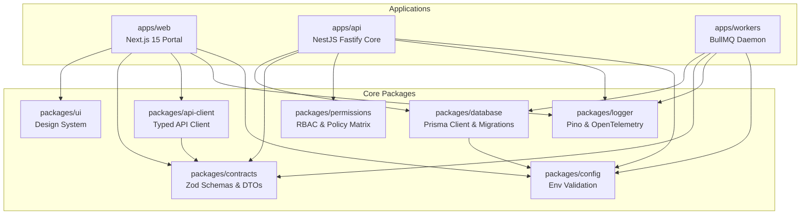
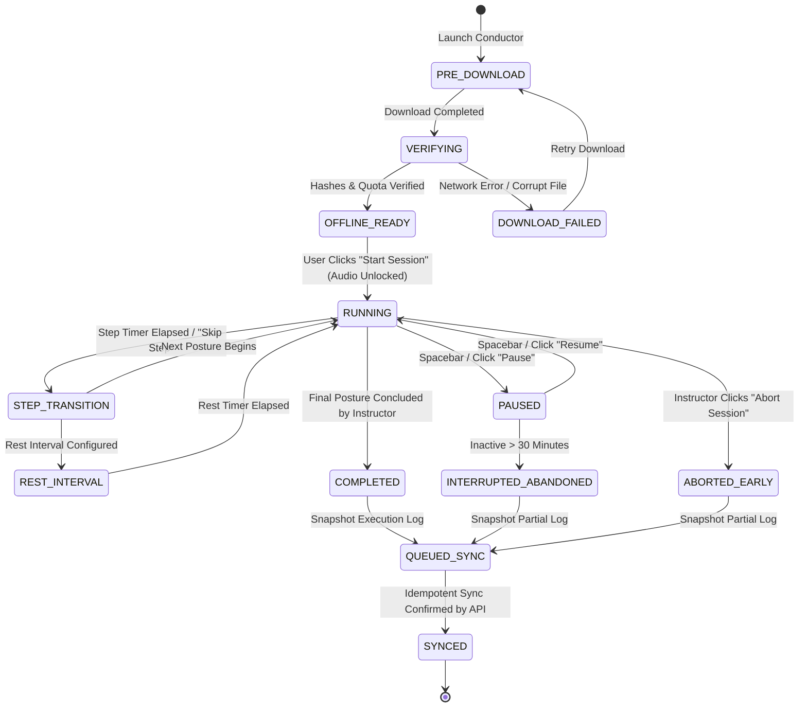
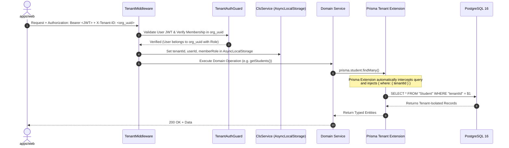
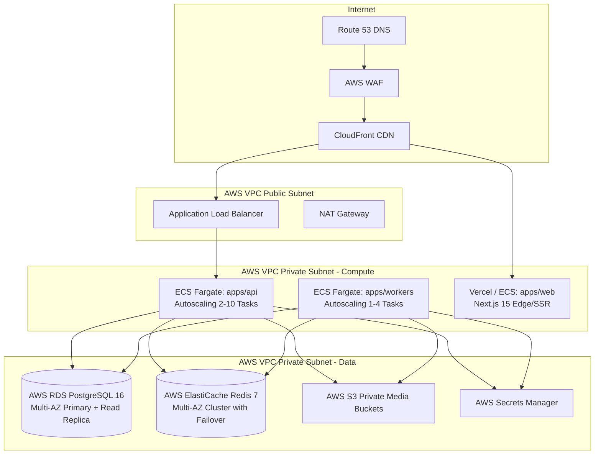

# YogaOS — System Architecture Design

**Document Reference:** `docs/architecture/SYSTEM_ARCHITECTURE.md`  
**Version:** 1.0.0 (System Architecture Baseline — Phase P04)  
**Status:** Approved for Implementation Planning  
**Role:** Principal Software Architect & Senior Cloud Solutions Engineer  

---

## 1. Architectural Principles & System Style

### 1.1 Architectural Pattern: Modular Monolith
YogaOS V1 is architected as a **Modular Monolith**. 

Rather than prematurely decomposing the application into distributed microservices—which introduces network latency, distributed transaction failure modes, complex tracing, and high operational overhead—the system is organized as a single deployable backend unit partitioned into strictly encapsulated, cohesive domain modules.

```
┌────────────────────────────────────────────────────────────────────────────────────────┐
│                                       YogaOS Web                                       │
│                    (Unified Next.js 15 Responsive Web Application)                     │
│   ┌───────────────────────┬─────────────────────────┬──────────────────────────────┐   │
│   │   Studio Management   │   Front Desk Check-in   │   Instructor / Conductor     │   │
│   └───────────────────────┴─────────────────────────┴──────────────────────────────┘   │
└───────────────────────────────────────────┬────────────────────────────────────────────┘
                                            │ HTTPS / JSON REST API (OpenAPI)
                                            ▼
┌────────────────────────────────────────────────────────────────────────────────────────┐
│                                  YogaOS Core API Engine                                │
│                         (NestJS with Fastify HTTP Platform)                            │
│  ┌──────────────────────────────────────────────────────────────────────────────────┐  │
│  │ Context & Security: TenantResolver -> AuthGuard -> PermissionGuard -> AuditLog   │  │
│  ├─────────────────┬───────────────────┬─────────────────────┬──────────────────────┤  │
│  │ Identity & Auth │ Organizations/Org │ Students & CRM      │ Scheduling & Batches │  │
│  ├─────────────────┼───────────────────┼─────────────────────┼──────────────────────┤  │
│  │ Bookings/Attnd  │ Memberships/Pass  │ Payments/GST Invoices│ Asana & Sequences   │  │
│  ├─────────────────┴───────────────────┴─────────────────────┴──────────────────────┤  │
│  │ Conductor Live State Controller & Offline Idempotent Event Ingestion Engine       │  │
│  └──────────────────────────────────────────────────────────────────────────────────┘  │
│                       │ Transactional Outbox                 │ Events / Queues         │
└───────────────────────┼──────────────────────────────────────┼─────────────────────────┘
                        ▼                                      ▼
           ┌────────────────────────┐             ┌─────────────────────────┐
           │   PostgreSQL 16 DB     │             │     Redis 7 Cluster     │
           │  (Tenant Partitioned)  │             │ (Cache, Locks & BullMQ) │
           └────────────────────────┘             └────────────┬────────────┘
                                                               │
                                                               ▼
                                                  ┌─────────────────────────┐
                                                  │   YogaOS Worker Engine  │
                                                  │   (Independent NestJS   │
                                                  │    Background Daemon)   │
                                                  │  - GST Invoice Render   │
                                                  │  - WhatsApp & Email     │
                                                  │  - Pass Auto-Expiry     │
                                                  │  - Waitlist Promotion   │
                                                  │  - Conductor Event Sync │
                                                  └─────────────────────────┘
```

### 1.2 Core Architectural Principles
1. **Zero Runtime AI for Live Class Execution:** The live execution of class sequences is completely deterministic. No AI model is in the critical path of timers, transitions, or media playback.
2. **2D Media Supremacy (No 3D / WebGL):** Strict reliance on real teacher video demonstrations, high-resolution static anatomical photography, and studio-recorded audio instructions. No 3D avatars, Three.js, or GLB assets.
3. **Decoupled Background Execution:** The HTTP API process (`apps/api`) does not process long-running jobs (PDF rendering, WhatsApp dispatch, media transcoding, or batch reconciliations). Heavy jobs are offloaded to Redis-backed BullMQ queues and executed by the worker daemon (`apps/workers`).
4. **Offline-First Resilience for Conductor:** Physical studio Wi-Fi in India can be erratic. The Automated Class Conductor is designed to download, verify, and execute classes 100% locally in browser memory/IndexedDB, queueing execution events and synchronizing idempotently upon network restoration.
5. **Strict Data Encapsulation:** Domain modules interact via strongly typed in-process services and asynchronous domain events. Direct database queries across domain boundaries are strictly forbidden.

---

## 2. Technology Stack Evaluation & Selection

| Layer | Technology Selected | Version / Spec | Technical Rationale & Architectural Fit |
| :--- | :--- | :--- | :--- |
| **Web Frontend** | **Next.js + React** | Next.js 15 (App Router), React 19, TypeScript | Server-Side Rendering (SSR) for SEO and initial portal load; Client Components with local state machines for the offline-ready Class Conductor. Single codebase for desktop, tablet, and TV displays. |
| **Styling & UI** | **Tailwind CSS + shadcn/ui + Radix** | Tailwind v4, Radix UI primitives | High accessibility (WAI-ARIA compliance), zero runtime CSS overhead, rapid design system iteration, full keyboard navigation support for front-desk speed. |
| **State & Forms** | **Zustand + TanStack Query + RHF + Zod** | Zustand v5, TanStack Query v5, Zod v3.24 | Server-state caching and automatic cache invalidation via TanStack Query; lightweight client-side state machine for Conductor via Zustand; strict runtime contract validation with Zod. |
| **Backend API** | **NestJS + Fastify** | NestJS v11, `@nestjs/platform-fastify` | Fastify delivers 2x–3x the HTTP throughput of Express, native JSON schema serialization, and lower memory footprint. NestJS provides enterprise-grade modular DI architecture. |
| **Database** | **PostgreSQL** | PostgreSQL 16 (AWS RDS) | Rock-solid relational transactions, JSONB for flexible sequence step metadata, native Row-Level Security (RLS) for defense-in-depth multi-tenant isolation. |
| **ORM & Data Layer** | **Prisma ORM** | Prisma v6 | Type-safe query generation, migration tooling, and Prisma Client Extensions (`$extends.query`) for automatic tenant isolation and field-level encryption of sensitive health data. |
| **Caching & Queues**| **Redis + BullMQ** | Redis 7 (AWS ElastiCache), BullMQ v5 | In-memory distributed caching, rate-limiting counters, distributed locks (Redlock), and resilient job queues with exponential backoff and dead-letter handling. |
| **Media Delivery** | **Cloudflare Stream / Mux + AWS S3** | S3 API, HLS / DASH Adaptive Bitrate | Presigned direct multipart uploads to private S3 buckets; automated transcoding into adaptive HLS video streams; static images cached and delivered globally via CloudFront CDN. |
| **Orchestration** | **Turborepo + pnpm** | pnpm 12.16.1, Turborepo 2.x | High-speed local build caching, deterministic dependency resolution, and strict boundary enforcement across packages. |
| **Logging & APM** | **Pino + OpenTelemetry + Sentry** | Pino v9, OpenTelemetry SDK, Sentry v8 | Structured JSON logging with trace context propagation, distributed tracing, and real-time client/server error aggregation. |

---

## 3. Monorepo Organization & Workspace Boundaries

```
yoga-studio-management/
├── apps/
│   ├── web/                    # Unified Next.js 15 Web Portal (Admin, Front Desk, Instructor, Conductor)
│   ├── api/                    # NestJS Fastify HTTP REST API Application
│   └── workers/                # NestJS Background Worker Daemon (BullMQ consumers)
├── packages/
│   ├── contracts/              # Single Source of Truth: Zod schemas, DTOs, API request/response types
│   ├── database/               # Prisma schema, migrations, seeders, typed PrismaClient with tenant extensions
│   ├── ui/                     # Shared UI components (shadcn/ui + Radix UI + Tailwind design tokens)
│   ├── permissions/            # RBAC matrix, permission definitions, policy enforcement guards
│   ├── logger/                 # Structured Pino logger with OpenTelemetry trace context wrapper
│   ├── config/                 # Type-safe environment variable validation schemas
│   └── api-client/             # Typed API client library (fetch wrapper + TanStack Query hooks)
├── infrastructure/
│   ├── docker/                 # Local development container definitions (Postgres 16 + Redis 7)
│   └── terraform/              # AWS IaC (RDS, ElastiCache, ECS Fargate, S3, CloudFront)
└── docs/                       # Product, Architecture, Agent & Discovery documentation
```

### Dependency Graph & Responsibility Boundaries



* **Boundary Rules:**
  1. `apps/web` **never** imports `packages/database`. All database operations must traverse `apps/api` via HTTPS.
  2. `packages/contracts` contains zero application code, runtime business logic, or database clients; it is strictly schemas and types.
  3. `apps/api` and `apps/workers` share the exact same `packages/database` client, ensuring schema synchronization and transaction parity.

---

## 4. Domain Module Architecture

The backend is partitioned into **21 discrete, cohesive domain modules** inside `apps/api/src/modules/`:

| Module Name | Primary Responsibility | Data Entities Owned | Main Dependencies | Key Domain Events Emitted |
| :--- | :--- | :--- | :--- | :--- |
| **1. Auth (`auth`)** | Global identity, credentials, sessions, JWT issuance. | `User`, `UserCredential`, `Session` | `config`, `logger`, `notifications` | `user.registered`, `session.created`, `password.reset` |
| **2. Organizations (`organizations`)** | Multi-tenant organization hierarchies & memberships. | `Organization`, `OrganizationMember` | `auth`, `permissions` | `org.created`, `member.invited`, `member.role_updated` |
| **3. Studios & Branches (`studios`)** | Physical studio branches, rooms, and floor capacities. | `Branch`, `Room` | `organizations` | `branch.created`, `room.capacity_updated` |
| **4. Roles & Permissions (`permissions`)** | Granular RBAC evaluation, branch scoping. | Permission policies (in-memory / config) | `organizations` | `permission.denied_audit` |
| **5. Students (`students`)** | Student profiles, emergency contacts, consent records. | `Student`, `StudentHealthDisclaimer`, `StudentNote` | `organizations`, `auth` | `student.registered`, `health_disclaimer.updated` |
| **6. Staff & Instructors (`staff`)** | Teacher profiles, credentials, teaching styles, bios. | `InstructorProfile`, `InstructorAvailability` | `organizations`, `auth` | `instructor.profile_updated`, `availability.changed` |
| **7. Classes (`classes`)** | Class types, intensities, default durations/capacities. | `ClassType` | `organizations` | `class_type.created`, `class_type.updated` |
| **8. Scheduling (`scheduling`)** | Weekly recurring batches, calendar sessions, substitutions. | `ClassBatchSchedule`, `ClassSessionInstance`, `ScheduleException` | `classes`, `studios`, `staff` | `session.scheduled`, `session.cancelled`, `instructor.substituted` |
| **9. Bookings (`bookings`)** | Spot booking, capacity checks, FIFO waitlists. | `Booking`, `WaitlistEntry` | `scheduling`, `students`, `memberships` | `booking.confirmed`, `booking.cancelled`, `waitlist.promoted` |
| **10. Attendance (`attendance`)** | Check-in verification, roster logging, no-show flags. | `AttendanceRecord` | `bookings`, `students`, `memberships` | `student.checked_in`, `student.no_show_recorded` |
| **11. Memberships (`memberships`)** | Plans, passes, credit deduction, freezes, expiration. | `MembershipPlan`, `StudentMembership`, `ClassPassCredit` | `organizations`, `students` | `membership.activated`, `pass.credit_deducted`, `membership.expired` |
| **12. Payments (`payments`)** | Multi-mode revenue logging (UPI, Cash, Card, Net Banking). | `PaymentTransaction`, `RefundRecord` | `memberships`, `students` | `payment.completed`, `payment.failed`, `refund.recorded` |
| **13. Tax & Invoicing (`invoicing`)** | Configurable GST calculation, SAC 9992, PDF tax invoices. | `TaxInvoice`, `InvoiceLineItem`, `CreditNote`, `TaxRateConfig` | `payments`, `organizations` | `invoice.generated`, `credit_note.issued` |
| **14. CRM & Leads (`crm`)** | Prospective inquiry pipeline, trials, follow-ups. | `LeadInquiry`, `LeadActivity` | `students`, `organizations` | `lead.created`, `lead.converted` |
| **15. Notifications (`notifications`)** | WhatsApp Cloud API, SMS, transactional email dispatch. | `NotificationLog` | `config`, `queue` | `notification.dispatched`, `notification.failed` |
| **16. Media (`media`)** | S3 presigned multipart uploads, asset verification, CDN. | `MediaAsset` | `config`, `organizations` | `media.uploaded`, `media.verified`, `media.deleted` |
| **17. Asana Library (`asana`)** | Classical Sanskrit/English posture taxonomy, anatomical tags. | `Asana`, `AsanaContraindication` | None (Platform global + tenant overrides) | `asana.created`, `asana.custom_added` |
| **18. Sequence Builder (`sequences`)** | Linear posture flows, step timers, bilateral splitting, versions. | `Sequence`, `SequenceVersion`, `SequenceStep` | `asana`, `media`, `organizations` | `sequence.draft_saved`, `sequence.published` |
| **19. Class Conductor (`conductor`)** | Deterministic live execution engine, offline sync ingestion. | `ConductorSession`, `ConductorExecutionEvent` | `sequences`, `scheduling`, `attendance` | `session.started`, `session.paused`, `session.completed`, `session.interrupted` |
| **20. Analytics (`analytics`)** | Daily collections, room occupancy rates, churn metrics. | Materialized views / aggregations | `attendance`, `payments`, `memberships` | `analytics.daily_aggregated` |
| **21. Audit Logging (`audit`)** | Immutable tenant audit trails, data access logs. | `AuditLog` | Global interceptor | `audit.security_logged` |

---

## 5. Offline-First Automated Class Conductor Architecture

The Automated Class Conductor is a mission-critical subsystem designed to execute reliably even during complete studio network blackouts.

```
┌────────────────────────────────────────────────────────────────────────────────────────┐
│                              Conductor Client Subsystem                                │
│                     (Browser-Based Client Execution & Local Storage)                   │
├────────────────────────────────────────────────────────────────────────────────────────┤
│  1. Pre-Download & Verification Pipeline                                               │
│     API -> Sequence Manifest -> Storage Estimate -> Download Assets -> Hash Verification │
│     -> Atomic Gate: Mark OFFLINE_READY                                                 │
├────────────────────────────────────────────────────────────────────────────────────────┤
│  2. Deterministic Execution State Machine (FSM)                                        │
│     - Wall-Clock Timing: Date.now() & performance.now() (Zero setInterval Drift)      │
│     - Synchronized Audio/Video via HTML5 AudioContext & Video Elements                 │
│     - Interactive Controls: Space (Pause/Resume), Right Arrow (Skip), +30s Hold Time   │
├────────────────────────────────────────────────────────────────────────────────────────┤
│  3. Local Persistence & Crash Recovery                                                 │
│     - State snapshotting every 3 seconds to IndexedDB                                  │
│     - Session Interruption Timeout: Paused > 30m -> INTERRUPTED_ABANDONED (Never Auto-Complete)│
├────────────────────────────────────────────────────────────────────────────────────────┤
│  4. Idempotent Synchronization Engine                                                  │
│     - Offline Events Queued in IndexedDB with Client-Generated UUIDs                   │
│     - Reconnection Detector -> Batch POST /api/v1/conductor/sessions/sync              │
└────────────────────────────────────────────────────────────────────────────────────────┘
```

### 5.1 Storage Selection & Quota Strategy
* **Storage Engine:** **IndexedDB** paired with the **Cache API** (for media blobs). 
  * *Rationale:* The Cache API provides native high-speed streaming integration with HTML5 `<video>` and `<audio>` tags through Service Worker caching, while IndexedDB stores structured step metadata, timers, and the offline event queue.
* **Storage Quota Enforcement:** Before initiating media downloads, the engine calls `navigator.storage.estimate()`. If available quota is under 500 MB (or less than 2x the sequence manifest size), the system alerts the instructor and triggers Least Recently Used (LRU) eviction of expired session media.

### 5.2 Deterministic Execution & Drift Prevention
* **Anti-Drift Timing Engine:** Standard `setInterval` or `setTimeout` timers suffer from severe drift (up to 5–10% drift in background tabs or throttled CPU states). The Conductor uses a **Wall-Clock Anchored RequestAnimationFrame (rAF) Loop**:
  $$\text{elapsed\_ms} = \text{Date.now}() - \text{step\_start\_timestamp} + \text{accumulated\_pause\_duration}$$
  This ensures that 60 seconds of hold time in the software matches exactly 60.000 seconds of real-world physical time.
* **Audio Autoplay Gate:** A high-visibility button ("Initialize Audio & Start Session") captures an explicit user click/tap, calling `audioContext.resume()` to unlock the browser's audio pipeline and prevent silent playback errors.

### 5.3 Anti-Auto-Complete & Session Lifecycle State Machine



* **Core Rule:** An interrupted, paused, or abandoned session is **NEVER** marked as `COMPLETED`. If a session is abandoned for >30 minutes, it automatically transitions to `INTERRUPTED_ABANDONED`, preserving exact partial duration and completed step counts.

---

## 6. Multi-Tenant & Identity Architecture

### 6.1 Multi-Studio Identity Model
YogaOS decouples the human identity (`User`) from the studio organization membership (`OrganizationMember`):
* A yoga instructor possesses **one global user account** (UUID, verified mobile phone, email, password hash).
* When invited to teach at multiple studios, the system creates independent `OrganizationMember` records.
* Each membership holds independent studio-specific roles, permissions, branches, teaching styles, and hourly rates.
* When using the web application, an **Organization Switcher** in the top navigation updates the active `tenant_id` context. Data queries strictly enforce this active tenant scope.

### 6.2 Tenant Context Resolution & Propagation Pipeline



* **Defense in Depth:** In addition to the application-level Prisma Client Extension automatically injecting `tenantId`, PostgreSQL **Row-Level Security (RLS)** policies can be enabled on sensitive tables as an infrastructure safeguard.

---

## 7. Sensitive Health Information Privacy Architecture

In compliance with India's **Digital Personal Data Protection (DPDP) Act 2023**, student health data (injuries, surgeries, pregnancy status, physical limitations) is treated as **Restricted Personal Data**:

1. **Explicit Consent Ledger:** Self-reported health notes require explicit student consent. The database stores `consentTimestamp`, `consentIpAddress`, and `consentVersion`.
2. **Field-Level Encryption at Rest:** The raw clinical narrative text is encrypted using **AES-256-GCM** with a tenant-derived data encryption key before being written to PostgreSQL.
3. **Role-Based Redaction & Privacy Boundaries:**
   * **Front Desk / Receptionist View:** The API completely strips the decrypted text and returns **only a non-clinical boolean indicator**: `{ hasHealthAlert: true, alertBadgeText: "CAUTION: Physical Restriction Flagged" }`. Receptionists cannot read medical details.
   * **Assigned Instructor & Studio Manager View:** Instructors assigned to the student's booked class receive the decrypted medical narrative on their private class roster to ensure physical adjustments are safe.

---

## 8. Billing, Configurable GST & Financial Operations

### 8.1 India-First Tax Computation Engine
Rather than hardcoding arbitrary tax assumptions, YogaOS implements a **Rule-Based Tax Engine**:
* **Studio Tax Configuration:** Each organization/branch defines:
  * `isGstRegistered`: Boolean flag.
  * `gstin`: 15-character Indian GST Identification Number.
  * `defaultTaxRate`: Configurable percentage (e.g., 18.00%, 12.00%, 5.00%, or 0.00% Exempt).
  * `sacCode`: Service Accounting Code (default: `9992` for Yoga & Fitness Training).
* **Tax Split Logic:**
  $$\text{If } \text{Branch.stateCode} == \text{Student.stateCode} \implies \text{CGST} = \frac{\text{Rate}}{2}, \text{SGST} = \frac{\text{Rate}}{2}$$
  $$\text{If } \text{Branch.stateCode} \neq \text{Student.stateCode} \implies \text{IGST} = \text{Rate}$$
* **Sequential Invoicing:** Invoices are assigned immutable, sequential numbering per studio branch per financial year (e.g., `INV/2026-27/0042`).

---

## 9. Cloud Infrastructure & Production Deployment Architecture



### Initial Practical AWS Hosting Recommendation
* **Web Frontend (`apps/web`):** Vercel Enterprise or AWS ECS Fargate container running Next.js standalone output.
* **API Engine (`apps/api`):** AWS ECS Fargate behind an Application Load Balancer (ALB) with SSL termination via AWS Certificate Manager (ACM).
* **Worker Daemon (`apps/workers`):** AWS ECS Fargate worker tasks (min: 1, max: 4) scaling on BullMQ queue depth metrics.
* **Database:** AWS RDS PostgreSQL 16 (db.t4g.medium initially, Multi-AZ enabled for production failover).
* **Cache & Queues:** AWS ElastiCache Redis 7 (cache.t4g.medium in cluster mode).
* **Object Storage & Video:** Private S3 bucket with CloudFront CDN for static assets; Cloudflare Stream / Mux for video transcoding and adaptive streaming.
* **Infrastructure as Code:** 100% defined in Terraform (`infrastructure/terraform/`).

---
*End of System Architecture Design.*
