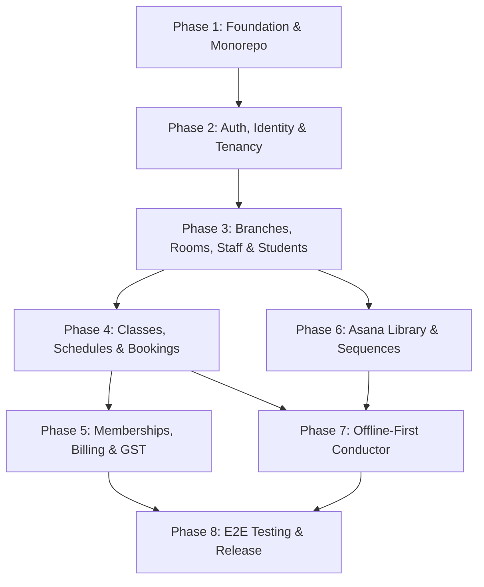

# YogaOS — Engineering Development Roadmap & Execution Plan

**Document Reference:** `docs/engineering/DEVELOPMENT_ROADMAP.md`  
**Version:** 1.0.0 (Engineering Baseline — Phase P05)  
**Status:** Approved for Implementation Execution  
**Role:** Principal Engineering Manager & Technical Lead  
**Execution Target:** 20 Structured Engineering Prompts  

---

## 1. Executive Roadmap & Phased Trajectory

To build YogaOS efficiently while maintaining strict engineering rigor, the 17 core workstreams are organized into **8 chronological implementation phases**. The sequence balances scaffold setup, backend domain services, UI integration, and testing.

```
┌────────────────────────────────────────────────────────────────────────────────────────┐
│                        YogaOS 8-Phase Engineering Trajectory                           │
├────────────────────────────────────────────────────────────────────────────────────────┤
│ Phase 1: Foundation, Monorepo & Core Packages (Prompts 1–3)                            │
│          Turborepo, pnpm workspaces, @yogaos/contracts, database, logger, ui           │
├────────────────────────────────────────────────────────────────────────────────────────┤
│ Phase 2: Global Identity, Auth & Multi-Tenancy (Prompts 4–5)                           │
│          Global User, Multi-Studio OrganizationMember, Prisma Tenant Extension, RBAC   │
├────────────────────────────────────────────────────────────────────────────────────────┤
│ Phase 3: Studio Core: Branches, Rooms, Staff & Students (Prompts 6–7)                  │
│          Branch config, student UUIDs, encrypted health privacy CRM, staff profiles   │
├────────────────────────────────────────────────────────────────────────────────────────┤
│ Phase 4: Classes, Schedules, Bookings & Attendance (Prompts 8–10)                      │
│          Class types, recurring batches, conflict checks, FIFO waitlist, 1-click roster│
├────────────────────────────────────────────────────────────────────────────────────────┤
│ Phase 5: Memberships, Passes, Billing & Configurable GST (Prompts 11–13)               │
│          Time & credit passes, freeze engine, multi-mode payments, sequential invoices │
├────────────────────────────────────────────────────────────────────────────────────────┤
│ Phase 6: Asana Library & Versioned Sequence Builder (Prompts 14–15)                    │
│          Sanskrit/English taxonomy, bilateral split, step timer builder, S3 presign    │
├────────────────────────────────────────────────────────────────────────────────────────┤
│ Phase 7: Offline-First Automated Class Conductor (Prompts 16–18)                       │
│          Media pre-download verification, wall-clock FSM, IndexedDB, idempotent sync  │
├────────────────────────────────────────────────────────────────────────────────────────┤
│ Phase 8: Operational Dashboard, E2E Verification & Release Hardening (Prompts 19–20)   │
│          Shift reconciliation, Playwright E2E flows, production deployment readiness   │
└────────────────────────────────────────────────────────────────────────────────────────┘
```

---

## 2. Detailed Workstream Specifications

### Phase 1: Foundation, Monorepo & Core Shared Packages
* **Covered Workstreams:** 
  * WS-01: Monorepo Foundation & Tooling (`turbo`, `pnpm-workspace.yaml`, root scripts)
  * WS-02: Shared Packages (`@yogaos/contracts`, `@yogaos/database`, `@yogaos/ui`, `@yogaos/logger`, `@yogaos/config`)
* **Objective:** Establish the development environment, shared contracts, database client, and UI design system foundations.
* **Key Deliverables:**
  * Root `package.json`, `pnpm-workspace.yaml`, `turbo.json`, `tsconfig.base.json`.
  * `packages/config`: Zod-validated environment schema.
  * `packages/logger`: Structured Pino logger with OpenTelemetry trace wrapper.
  * `packages/contracts`: Baseline Zod schemas for all shared DTOs and API envelopes.
  * `packages/database`: Canonical Prisma schema, initial migration, and client factory.
  * `packages/ui`: Tailwind CSS tokens, Radix UI primitives, shadcn/ui components.
  * `apps/api`: Initial NestJS Fastify application skeleton.
  * `apps/web`: Initial Next.js 15 App Router skeleton.
  * `infrastructure/docker/docker-compose.yml`: Local PostgreSQL 16 + Redis 7 services.
* **Dependencies:** Verified local Node 24, pnpm 12, Git, and running Docker daemon.
* **Critical Acceptance Criteria:** `pnpm build`, `pnpm lint`, and `pnpm test` execute cleanly across all packages in Turborepo cache. Local Postgres and Redis connect successfully.
* **Required Tests:** Workspace build tests, Prisma connection tests, Zod validation unit tests.
* **Completion Condition:** Clean, error-free monorepo build with running local backing services.

---

### Phase 2: Global Identity, Authentication & Multi-Tenancy Engine
* **Covered Workstreams:**
  * WS-03: Authentication & Identity (`auth`)
  * WS-04: Multi-Tenant Organizations, Memberships & Permissions (`organizations`, `permissions`)
* **Objective:** Implement the global user identity model, studio organization memberships, studio context switching, and automated dual-layer tenant data isolation.
* **Key Deliverables:**
  * User registration and login endpoints (Argon2id hashing, secure JWT / HTTP-only cookies).
  * `Organization` and `OrganizationMember` models supporting multi-studio teachers.
  * `TenantResolverMiddleware` and `TenantAuthGuard` resolving `X-Tenant-ID`.
  * Prisma Client Extension (`@yogaos/database`) automatically injecting `{ where: { tenantId } }`.
  * Predefined RBAC guard (`OWNER`, `MANAGER`, `INSTRUCTOR`, `RECEPTIONIST`) with branch scoping.
  * Web login, registration, and top-bar studio context switcher.
* **Dependencies:** Phase 1 (database, contracts, config).
* **Critical Acceptance Criteria:** User can register once, be invited to multiple studios, and toggle studio contexts. Cross-tenant data access is blocked at both ORM and API levels.
* **Required Tests:** Auth unit tests, JWT token tests, tenant-isolation penetration tests (verifying Tenant A cannot read Tenant B data).
* **Completion Condition:** Quality Gate 2 (Multi-Tenant Security) fully passed.

---

### Phase 3: Studio Core — Branches, Rooms, Staff & Student Health Privacy
* **Covered Workstreams:**
  * WS-05: Studio, Branch and Room Management (`studios`)
  * WS-06: Students, Instructors and Staff (`students`, `staff`)
* **Objective:** Enable multi-branch and room capacity management, instructor profile setups, and student CRM with DPDP Act-compliant encrypted health notes.
* **Key Deliverables:**
  * Branch and room management CRUD with Indian GST state codes and room mat capacities.
  * Staff invitation and instructor profile management (teaching styles, bio, certifications).
  * Student registration with decoupled immutable UUID (`student_id`) and mutable phone/email.
  * Student health disclaimer form with affirmative consent logging and AES-256-GCM field encryption.
  * Non-clinical front-desk health indicator (`CAUTION` badge) vs full instructor clinical view.
* **Dependencies:** Phase 2 (auth, tenancy, permissions).
* **Critical Acceptance Criteria:** Room capacities enforced; student health text encrypted in DB; front desk sees caution badge without clinical narrative; instructors see full notes for enrolled students.
* **Required Tests:** Encryption/decryption unit tests, role-based field redaction tests, branch scoping tests.
* **Completion Condition:** Students, branches, and instructors successfully modeled with verified privacy boundaries.

---

### Phase 4: Classes, Schedules, Bookings, Waitlists & Attendance
* **Covered Workstreams:**
  * WS-07: Classes, Batches and Scheduling (`classes`, `scheduling`)
  * WS-08: Booking, Waitlists and Attendance (`bookings`, `attendance`)
* **Objective:** Implement class catalogs, recurring weekly batch scheduling with cross-studio conflict checks, spot bookings, automated FIFO waitlists, and 1-click attendance.
* **Key Deliverables:**
  * Class type catalog (title, style, level, duration, capacity).
  * Recurring weekly batch generator with room and cross-studio instructor overlap detection.
  * Calendar session instance generator and substitute teacher manager.
  * Booking engine enforcing room capacity limits and membership credit validation.
  * Automated FIFO waitlist engine with auto-promotion upon cancellation.
  * Rapid front-desk 1-click check-in roster with safety badges and no-show tracking.
* **Dependencies:** Phase 3 (rooms, students, instructors).
* **Critical Acceptance Criteria:** Overlapping instructor bookings blocked across all studio affiliations; waitlist auto-promotes student on cancellation; check-in latencies under 500ms.
* **Required Tests:** Concurrency booking tests, instructor double-booking tests, waitlist promotion tests, check-in state tests.
* **Completion Condition:** Full scheduling and attendance lifecycle operational.

---

### Phase 5: Memberships, Passes, Billing & Configurable GST Invoicing
* **Covered Workstreams:**
  * WS-09: Memberships, Passes and Renewals (`memberships`)
  * WS-10: Payments, Configurable Tax and Invoicing (`payments`, `invoicing`)
* **Objective:** Deliver commercial monetization: time-based subscriptions, credit packs, freeze rules, multi-mode payment logging, and statutory Indian GST invoicing.
* **Key Deliverables:**
  * Membership plan definitions (Unlimited time, Class Packs, Drop-ins).
  * Student membership assignment, auto-credit allocation, and automated expiration background worker.
  * Membership freeze engine pausing credit validity and extending expiry dates.
  * Payment recording across UPI (with UTR reference), Cash, Card, and Net Banking.
  * Configurable GST tax engine: CGST+SGST (intra-state) vs IGST (inter-state) based on branch/student state.
  * Immutable sequential GST tax invoice generator with SAC 9992 itemization.
  * End-of-shift daily cash and collections summary.
* **Dependencies:** Phase 4 (bookings, attendance).
* **Critical Acceptance Criteria:** Credit passes decrement accurately on check-in; tax calculations split 100% mathematically correct; sequential invoice numbers have zero gaps.
* **Required Tests:** Tax calculation matrix tests (intra vs inter-state vs exempt), credit decrement concurrency tests, freeze extension tests.
* **Completion Condition:** Studio can issue valid GST tax invoices and track membership revenue.

---

### Phase 6: Asana Library, Media Pipeline & Versioned Sequence Builder
* **Covered Workstreams:**
  * WS-11: Asana Library and Media Management (`asana`, `media`)
  * WS-12: Sequence Builder and Versioning (`sequences`)
* **Objective:** Establish the classical posture repository, presigned media upload pipeline, and step-based sequence builder with bilateral symmetry and version immutability.
* **Key Deliverables:**
  * Classical asana taxonomy (Sanskrit IAST + English names, anatomical focus, contraindications).
  * S3 presigned multipart upload service with SHA-256 asset hash generation.
  * Visual step-based sequence builder (posture hold durations, breath counts, rest intervals).
  * Bilateral symmetry flag auto-generating explicit Right-Side and Left-Side holds.
  * Media binding (attaching MP3 voice cues, MP4 demo video clips, and JPG/PNG alignment photos).
  * Sequence versioning engine: Editing published sequences creates immutable new versions (`v1.1`), preserving historical class integrity.
* **Dependencies:** Phase 3 (instructors, media).
* **Critical Acceptance Criteria:** Asana search returns dual Sanskrit/English results; media uploads verify SHA-256 hashes; sequence publishing locks earlier versions.
* **Required Tests:** Sequence versioning integrity tests, bilateral step generation tests, S3 presigned upload tests.
* **Completion Condition:** Teachers can build, version, and publish complete practice flows.

---

### Phase 7: Offline-First Automated Class Conductor Engine
* **Covered Workstreams:**
  * WS-13: Automated Class Conductor Core & Display (`conductor`)
  * WS-14: Offline Playback, Pre-Download Verification & Event Synchronization (`conductor`)
* **Objective:** Build the proprietary deterministic in-studio execution engine capable of executing 100% locally in browser memory without internet and syncing events idempotently.
* **Key Deliverables:**
  * Media pre-download pipeline: downloading sequence assets into IndexedDB and Cache API, validating SHA-256 checksums, and atomically marking `OFFLINE_READY`.
  * Browser storage quota monitor (`navigator.storage.estimate()`) with LRU cache eviction.
  * High-visibility "Initialize Audio & Start Session" user gesture unlocking Web Audio API.
  * Anti-drift execution state machine (FSM) driven by wall-clock time (`performance.now()`).
  * High-contrast fullscreen studio display (Sanskrit/English posture names, countdown timer, Left/Right side badge, next posture preview).
  * Instructor controls: Spacebar (Pause/Resume), Right Arrow (Skip), `+30s` hold time adjustment.
  * Anti-auto-complete protection: Paused sessions inactive for >30m transition to `INTERRUPTED_ABANDONED` (NEVER `COMPLETED`).
  * Local IndexedDB event queue with client UUIDs; idempotent sync endpoint `/api/v1/conductor/sessions/sync`.
* **Dependencies:** Phase 6 (sequences, media).
* **Critical Acceptance Criteria:** Conductor runs 60-minute class with zero sound overlap, zero timer drift, and zero internet connection; interrupted sessions never auto-complete; post-reconnect sync creates zero duplicate logs.
* **Required Tests:** Timer drift tests, audio context unlock tests, simulated offline execution tests, idempotent sync replay tests.
* **Completion Condition:** Quality Gate 5 (Conductor Readiness) fully verified.

---

### Phase 8: Operational Dashboard, E2E Verification & Release Hardening
* **Covered Workstreams:**
  * WS-15: Operational Dashboard & Analytics (`analytics`, `studios`)
  * WS-16: External Integrations & Notifications (`notifications`)
  * WS-17: End-to-End System Testing & Release Readiness
* **Objective:** Deliver operational reporting, WhatsApp/email notification worker queues, execute comprehensive Playwright E2E tests, and prepare production deployment manifests.
* **Key Deliverables:**
  * Studio operations overview dashboard (today's schedule, check-in rate, daily revenue).
  * BullMQ worker pipelines for transactional notifications (WhatsApp Cloud API / Email).
  * Comprehensive Playwright E2E test suite covering Owner Onboarding -> Class Creation -> Booking -> Check-in -> Payment -> Conductor Execution.
  * Production Dockerfile, health check endpoints (`/health/live`, `/health/ready`), and Terraform IaC templates.
* **Dependencies:** Phases 1–7.
* **Critical Acceptance Criteria:** All 42 P0 features verified working; 100% automated test suite passing; sub-second page loads.
* **Required Tests:** Playwright E2E browser suite, full regression suite, load/stress test on Conductor sync endpoint.
* **Completion Condition:** Final Quality Gate 6 (Release Readiness) certified.

---

## 3. Critical Path & Dependency Bottlenecks



### Critical Path Bottlenecks:
1. **Tenant Isolation & Auth (Phase 2):** Every business module depends on `tenantId` injection. Must be established and locked early.
2. **Scheduling & Room Allocation (Phase 4):** Both Bookings and the Conductor depend on `class_session_instances`.
3. **Conductor Media Integrity & Storage (Phase 7):** Highest architectural risk. Must validate IndexedDB caching and Web Audio autoplay unlocking thoroughly.

---

## 4. Antigravity Agent Execution Protocol

To maintain velocity and code quality across the 20-prompt execution target:

### Rules for the Lead Agent:
1. **Pre-Implementation Review:** Inspect `MASTER_PRD.md`, `SYSTEM_ARCHITECTURE.md`, and `DATABASE_ARCHITECTURE.md` before generating code.
2. **Atomic Commits & Checkpoints:** Commit files logically at the conclusion of each prompt.
3. **Continuous Verification:** Run unit and integration tests after modifying any domain module. Never mark a workstream complete without passing tests.
4. **Implementation Tracker Updates:** Update `docs/engineering/IMPLEMENTATION_STATUS.md` at each milestone.

### Subagent Delegation Boundaries:
* **Safe for Subagents (Parallel Execution):**
  * Generating isolated Zod contract schemas in `packages/contracts`.
  * Implementing pure UI presentation components in `packages/ui`.
  * Seeding the classical 84-asana catalog in `packages/database`.
  * Writing standalone unit test suites for pure business calculation logic (e.g., GST tax split calculations).
* **Must Remain Under Lead Agent (Single Context):**
  * Core multi-tenant Prisma extension and PostgreSQL RLS policies.
  * Authentication middleware and session token lifecycle.
  * Database schema migrations and foreign key constraints.
  * Automated Class Conductor state machine, timing loop, and offline sync engine.

---
*End of Engineering Development Roadmap.*
