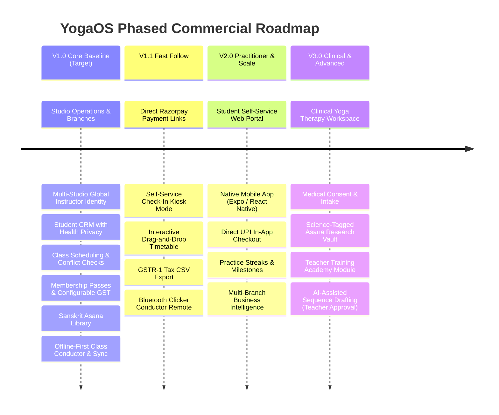

# YogaOS — MVP Scope Definition & Release Strategy

**Document Reference:** `docs/product/MVP_SCOPE.md`  
**Version:** 1.1.0 (V1 Baseline Finalization — Phase P03)  
**Status:** Approved Technical Baseline  
**Author:** Senior Product Architect & Technical Product Manager  

---

## 1. First-Release Objective & Core Value Proposition

### 1.1 Objective Statement
The primary objective of the YogaOS V1.0 initial release is:

> **To empower a real, operating yoga studio in India to manage its complete daily business operations (scheduling, multi-room branch operations, student check-in, memberships, and configurable GST invoicing) while enabling certified yoga instructors—operating across one or multiple studios—to curate structured posture sequences and conduct live, deterministic, offline-resilient guided classes using the Automated Class Conductor.**

### 1.2 Core Value Proposition
* **For Studio Owners:** Eliminates fragmented spreadsheets and manual WhatsApp tracking, provides airtight attendance and configurable GST tax compliance, and maintains standardized class quality across all branches.
* **For Yoga Instructors:** Provides a unified multi-studio teaching portal with a single global identity, personal sequence library, and an offline-ready Class Conductor that automates countdowns, media cues, and interval bells—freeing teachers to focus entirely on hands-on student adjustments, safety, and alignment.
* **For Students:** Guarantees punctual, structured, and immersive practice sessions while ensuring their self-reported injuries and health conditions are safely acknowledged prior to stepping onto the mat.

---

## 2. In-Scope Modules & V1 Baseline Deliverables (42 P0 Features)

The V1 baseline follows a broad MVP approach encompassing 42 non-negotiable P0 features across 8 core modules:

```
┌────────────────────────────────────────────────────────────────────────┐
│                        YogaOS V1.0 Core Baseline                       │
├──────────────────────────────────┬─────────────────────────────────────┤
│ 1. Multi-Tenant Organization     │ 5. Bookings, Waitlist & Check-In    │
│    - Studio & Branch setup       │    - Capacity validation            │
│    - Room management             │    - FIFO auto-waitlist             │
│    - Operational dashboard       │    - 1-click roster check-in        │
├──────────────────────────────────┼─────────────────────────────────────┤
│ 2. Staff & Multi-Studio RBAC     │ 6. Memberships & Class Passes       │
│    - Global account identity     │    - Unlimited time plans           │
│    - Studio memberships & switch │    - Fixed credit packs             │
│    - Branch-scoped permissions   │    - Freeze & expiry engine         │
├──────────────────────────────────┼─────────────────────────────────────┤
│ 3. Student CRM & Health Privacy  │ 7. Billing & Configurable GST       │
│    - Immutable internal UUID     │    - Multi-mode payment recording   │
│    - Mutable phone/email login   │    - Configurable GST rates/SAC     │
│    - Privacy-bound injury alert  │    - Sequential tax invoices        │
├──────────────────────────────────┼─────────────────────────────────────┤
│ 4. Classes & Batch Scheduling    │ 8. Instructor & Offline Conductor   │
│    - Class type catalog          │    - Sanskrit/English Asana catalog │
│    - Recurring weekly batches    │    - Step-based sequence builder    │
│    - Cross-studio conflict check │    - Pre-downloaded verified media  │
│    - Substitute teacher manager  │    - 100% offline execution & sync  │
└──────────────────────────────────┴─────────────────────────────────────┘
```

### Detailed Inclusions Table

| Module | Included P0 Capabilities | Excluded from V1 |
| :--- | :--- | :--- |
| **Organization & Branches** | Single organization with multiple physical branches, room setup, capacity limits, operational overview dashboard. | Automated branch-to-branch inventory transfer, multi-currency consolidated P&L. |
| **Staff & Multi-Studio RBAC** | Single global user identity, studio-specific `OrganizationMember` records, multi-studio workspace switcher, predefined roles (`OWNER`, `MANAGER`, `INSTRUCTOR`, `RECEPTIONIST`), branch scoping. | Dynamic custom RBAC role builder, staff payroll calculation. |
| **Student Management & Privacy** | Immutable internal `student_id` (UUID), mutable phone/email identifiers, consent logging, privacy boundary (front desk sees `CAUTION` badge; clinical details restricted to assigned teachers/managers). | Self-service student portal, digital signature canvas. |
| **Classes & Scheduling** | Class type catalog, recurring weekly batches, single workshops, cross-studio instructor conflict checks, schedule exceptions. | Automated algorithmic instructor optimization. |
| **Booking & Attendance** | Class capacity enforcement, automated FIFO waitlist, auto-promotion on cancellation, front-desk check-in, no-show tracking. | Student self-booking mobile app, facial recognition check-in. |
| **Memberships & Passes** | Time-based unlimited plans, class credit packs, drop-in passes, manual membership freeze/extension, auto-expiration. | Automated recurring credit card subscription rebilling (e-mandate). |
| **Billing & Configurable Tax** | Manual recording of UPI (UTR), Cash, Card, Net Banking; configurable GST tax engine (rates, SAC 9992, tax-exempt toggle, CGST/SGST/IGST splits); sequential tax invoices; daily cash summary. | Live Razorpay checkout popup embedded in front desk (links can be shared manually). |
| **Instructor Workspace** | Multi-studio schedule view with studio context switcher, roster review with protected injury notes, sequence linking. | Instructor payout and commission tracking. |
| **Asana Library** | Classical posture taxonomy (Sanskrit IAST + English), anatomical tags, difficulty, custom posture creation, bilateral step builder. | AI-generated class sequences, automated biomechanical pose grading. |
| **Offline-First Class Conductor**| Deterministic state machine, large-format studio screen, audio cues, video/image media, pause/resume, skip, +30s adjustment, browser autoplay unlock, media pre-download verification, 100% offline playback, idempotent sync, anti-auto-complete protection. | Autonomous camera-based tracking, 3D animated avatars. |

---

## 3. Explicit Exclusions & Out-of-Scope Capabilities

To ensure strict engineering discipline and prevent feature bloat, the following items are **explicitly barred** from the V1.0 release:

1. **No 3D Avatars, Three.js, or GLB Animation Systems:**
   * *Rationale:* 3D graphics introduce significant rendering overhead, device compatibility failures on low-end studio screens, high authoring costs, and an artificial "video-game" feel that undermines authentic yoga pedagogy. Real human video and high-resolution anatomical photography are vastly superior.
2. **No AI-Driven Live Class Decision-Making:**
   * *Rationale:* Live class pacing must remain 100% deterministic and under the direct command of the human instructor. An unvetted AI altering timings mid-class introduces physical safety hazards.
3. **No Automatic Completion of Abandoned Sessions:**
   * *Rationale:* If an instructor pauses or walks away from a class session, it must never be marked `COMPLETED`. An abandoned session is recorded as `INTERRUPTED_ABANDONED` after 30 minutes of inactivity, maintaining accurate attendance and payroll auditing.
4. **No Standalone Native Mobile Practitioner App:**
   * *Rationale:* Mobile app development across iOS and Android dramatically expands QA scope and app store review overhead. V1 operations are managed via responsive web by studio staff and instructors. Students interact via WhatsApp confirmations and transactional emails.
5. **No Clinical Therapy Workspace:**
   * *Rationale:* Yoga therapy for clinical conditions involves complex medical record confidentiality, diagnostic boundaries, and healthcare compliance. It will be architected as a separate, specialized module in V3.
6. **No Premature Microservices:**
   * *Rationale:* The system will be implemented as a clean, highly structured modular monolith (NestJS + Next.js) with BullMQ workers, avoiding the operational drag and distributed latency of microservices.

---

## 4. Phased Product Roadmap



---

## 5. Release Success Criteria & Acceptance Thresholds

The V1.0 release will be considered commercially and technically ready for production rollout only when it satisfies all of the following empirical thresholds:

### 5.1 Operational & Functional Criteria
* **End-to-End Operational Lifecycle:** A studio owner can onboard, create 2 branches, register an instructor, enroll 20 students, create a recurring batch, sell 10-class packs, issue compliant GST invoices, check in students, and complete a 60-minute class with the Conductor without administrator intervention.
* **Multi-Studio Instructor Isolation:** An instructor teaching at Studio A and Studio B can toggle workspaces with 1 click; no schedule, student roster, or financial data leaks between the two studios.
* **Tax Invoicing Accuracy:** 100% mathematical accuracy on CGST/SGST/IGST tax breakdowns across all generated PDF invoices under both registered and tax-exempt studio configurations.

### 5.2 Conductor Offline Reliability & Playback Criteria
* **Pre-Download Verification:** 100% of required sequence video, image, and audio assets pass local storage hash/size checks before the session is marked `OFFLINE_READY`.
* **Zero Sound Overlap:** Voice cues and chime audio trigger without clipping, distortion, or overlapping voice tracks.
* **Autoplay Resilience:** 100% of tested browser environments (Chrome, Edge, Safari on macOS, Windows, iPadOS) successfully play class audio following the single initial "Initialize & Start" tap.
* **Complete Offline Class Execution:** When simulated network failure (Wi-Fi disconnect) is applied mid-class, an ongoing 60-minute Conductor session completes all posture timers, transitions, and local audio cues without crashing or freezing.
* **Idempotent Synchronization:** Upon network reconnect, 100% of queued offline execution events synchronize to the backend API without creating duplicate attendance or billing records.
* **Anti-Auto-Complete Verification:** Paused sessions left unattended for 30 minutes correctly transition to `INTERRUPTED_ABANDONED` and never report as `COMPLETED`.

### 5.3 Performance & Ergonomic Criteria
* **Check-In Speed:** Single student check-in on the front-desk roster executes in under 500ms on a standard broadband connection.
* **Conductor Display Legibility:** Critical telemetry (posture name, countdown timer, left/right side indicator) remains easily readable from a distance of 8 meters on a standard 55-inch studio TV display.

---

## 6. Preserved Open Business Decisions Log

The following three business decisions are preserved as open stakeholder questions, with architecture hooks built into the V1 design:

| Decision Ref | Category | Core Decision / Question | Working Architecture Baseline | Stakeholder Action Required |
| :--- | :--- | :--- | :--- | :--- |
| **OQ-01** | Finance | Should studio staff be allowed to manually waive GST for specific students or packages? | **Configurable per plan/transaction.** Default is strict enforcement of studio tax rules. | Confirm with studio accounting advisors. |
| **OQ-02** | Operations | Can a student be checked in if their membership expired recently (grace period)? | **Configurable studio setting:** `ALLOW_EXPIRED_CHECKIN_WITH_WARNING`. Requires staff override. | Confirm operational grace period policy. |
| **OQ-03** | Operations | Are drop-in class pass cancellations refundable as cash or strictly store credit? | **System supports both recording modes.** Studio permission flags govern front-desk cash refunds. | Confirm consumer refund terms. |

---
*End of MVP Scope Definition & Release Strategy.*
