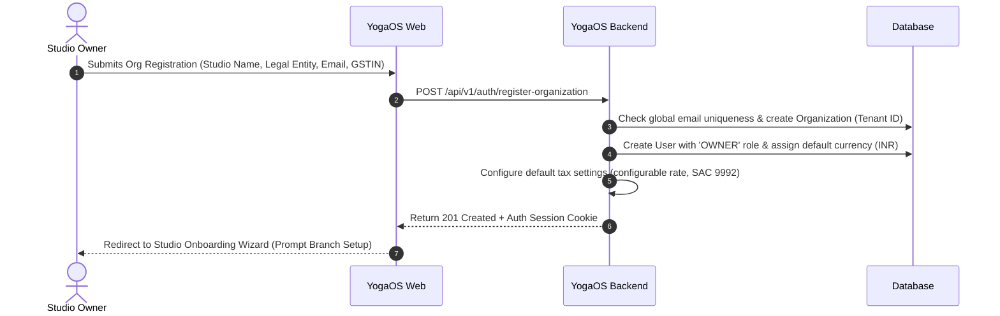
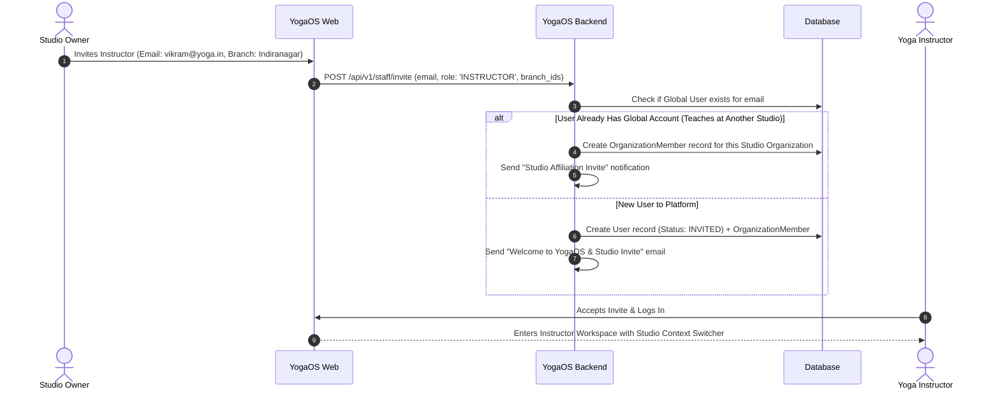
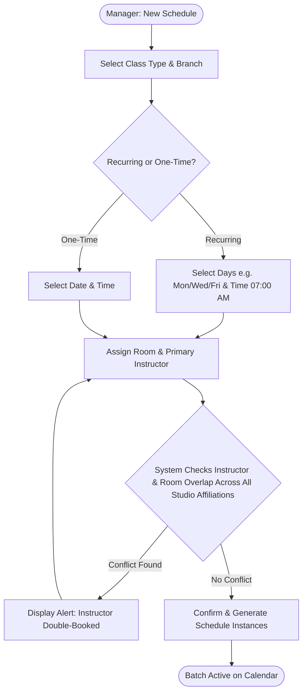
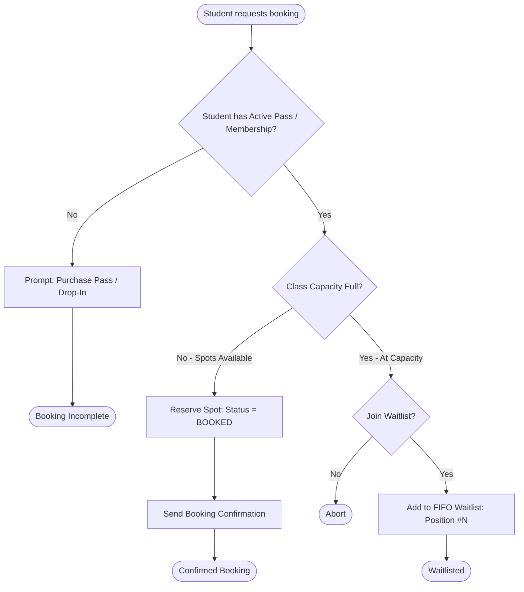
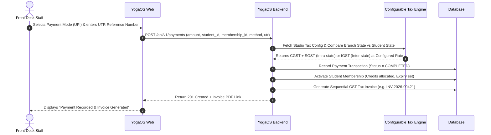
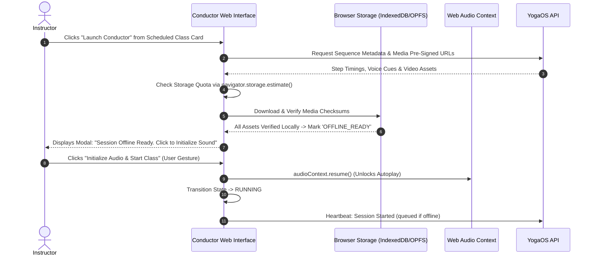
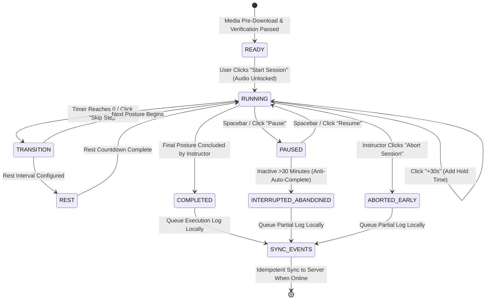

# YogaOS — Primary User Workflows & Operational Journeys

**Document Reference:** `docs/product/USER_FLOWS.md`  
**Version:** 1.1.0 (V1 Baseline Finalization — Phase P03)  
**Status:** Approved Technical Baseline  
**Author:** Senior Product Architect & Technical Product Manager  

---

## 1. Overview of Core Platform Workflows

This document establishes the canonical step-by-step user journeys for YogaOS across administrative operations, multi-studio identity, student management, configurable tax billing, and the offline-first **Automated Class Conductor**.

Every workflow is structured with explicit:
* **Starting Conditions:** System prerequisites required before entering the flow.
* **User Actions:** Chronological actions performed by the operator.
* **System Responses:** State updates, validations, and UI feedback triggered by the system.
* **Successful Outcomes:** The definitive end state of the transaction.
* **Exceptions & Failure Cases:** Validation errors, race conditions, or network interruptions.

---

## 2. Administrative & Multi-Studio Setup Workflows

### Flow 1: Studio Owner Onboarding & Organization Setup

* **Starting Condition:** Owner accesses registration page; has valid email and organization details.
* **User Actions:**
  1. Enters Studio Name (e.g., "Prana Yoga Shala"), Legal Entity Name, Owner Full Name, Email, and Password.
  2. Enters Indian GSTIN (optional if turnover is below statutory threshold) and confirms tax status (Registered vs Composition/Exempt).
  3. Clicks "Create Studio Organization".
* **System Response:** Creates isolated tenant record (`tenant_id`), provisions Owner account with root privileges, sets default currency to INR (`₹`), seeds standard classical asana catalog, initializes configurable tax rules, and generates secure authentication session.
* **Successful Outcome:** Owner lands on the Setup Wizard to configure their first physical studio branch.
* **Exception Cases:**
  * *Duplicate Email:* System returns 409 Conflict alert and prompts login or password reset.
  * *Invalid GSTIN:* System performs checksum validation on GSTIN format (`22AAAAA0000A1Z5`); alerts user if invalid without blocking registration if flagged as non-registered.

---

### Flow 2: Creating a Studio Branch

* **Starting Condition:** Authenticated as Studio Owner; organization exists.
* **User Actions:**
  1. Navigates to **Settings > Branches** and clicks "Add Branch".
  2. Enters Branch Name (e.g., "Indiranagar Shala"), Physical Street Address, City, State (dropdown of Indian States & UTs with GST state codes), and PIN Code.
  3. Configures default operating hours and timezone (`Asia/Kolkata`).
  4. Adds initial practice room(s) (e.g., "Satsang Hall", capacity: 25).
  5. Clicks "Save Branch".
* **System Response:** Validates state code against GST master registry; creates branch record linked to `tenant_id`; binds rooms to the branch.
* **Successful Outcome:** Branch appears in the active branch switcher and is available for schedule creation.
* **Exception Cases:**
  * *Missing Mandatory Fields:* Address, State, or Room Capacity missing prevents form submission with inline validation errors.

---

### Flow 3: Adding an Instructor (Multi-Studio Identity Support)

* **Starting Condition:** Authenticated as Owner or Studio Manager; target instructor email is known.
* **User Actions:**
  1. Navigates to **Staff Directory** and clicks "Add Staff Member".
  2. Enters Instructor Email (e.g., `vikram@yoga.in`), Full Name, and Mobile Phone.
  3. Selects Role: `INSTRUCTOR`.
  4. Selects Branch Assignment(s) (e.g., "Indiranagar Shala").
  5. Clicks "Send Invitation".
* **System Response:**
  * Checks if a Global User exists with that email:
    * If existing (e.g., instructor already teaches at another YogaOS studio): Creates an `OrganizationMember` record linking the existing user account to this studio organization. Dispatches studio invitation alert.
    * If new: Creates a global user record (`PENDING_INVITE`) and links the `OrganizationMember` record. Dispatches full invitation email with setup link.
* **Successful Outcome:** Instructor accepts invite and accesses the **Instructor Workspace**. An organization switcher in the top navigation allows toggling between studios without cross-tenant data leakage.

---

## 3. Student & Scheduling Workflows

### Flow 4: Registering a Student (Decoupled Identity & Privacy)

* **Starting Condition:** Front Desk Staff or Manager is logged in at a specific branch.
* **User Actions:**
  1. Navigates to **Students** or clicks quick-action shortcut "New Student" (`Alt+N`).
  2. Enters Full Name, Mobile Phone (10-digit Indian mobile format), and Email.
  3. Selects Home Branch and enters Date of Birth / Gender.
  4. Enters Emergency Contact Name and Phone.
  5. Logs any reported physical conditions, past injuries, surgeries, or pregnancy flags.
  6. Ticks "Student acknowledged studio health disclaimer & terms".
  7. Clicks "Register Student".
* **System Response:**
  * Generates an internal immutable UUID (`student_id`).
  * Treats mobile phone and email as mutable contact/login identifiers, allowing future updates without breaking historical billing, attendance, or passes.
  * Encrypts self-reported health narratives; flags profile with a high-level non-clinical `CAUTION` badge visible to front desk; records consent timestamp.
* **Successful Outcome:** Student profile opens, ready for membership assignment or class booking.
* **Exception Cases:**
  * *Duplicate Phone Number within Studio:* System warns: "A student with phone +91 98765 43210 already exists: Priya Sharma. View existing profile or proceed with new record?"

---

### Flow 5: Creating a Class Type

* **Starting Condition:** Authenticated as Studio Owner or Manager.
* **User Actions:**
  1. Navigates to **Classes > Class Types** and clicks "New Class Type".
  2. Enters Title (e.g., "Morning Ashtanga Primary"), Category (Vinyasa/Hatha/Pranayama), and Level (Intermediate).
  3. Sets Default Duration (e.g., 75 minutes) and Default Capacity (e.g., 20 mats).
  4. Adds student preparation guidance (e.g., "Bring your own mat; practice on an empty stomach").
  5. Clicks "Save Class Type".
* **System Response:** Persists reusable class template under the organization.
* **Successful Outcome:** Class Type is available in batch and scheduling dropdowns.

---

### Flow 6: Creating a Batch and Schedule

* **Starting Condition:** Class Type, Branch Rooms, and Instructors exist.
* **User Actions:**
  1. Navigates to **Schedule > Timetable** and clicks "Add Schedule".
  2. Selects Class Type, Branch, and Practice Room.
  3. Selects Recurrence: Recurring (e.g., Every Monday, Wednesday, Friday from 07:00 AM to 08:15 AM).
  4. Sets effective date range (e.g., Nov 1, 2026 to Dec 31, 2026).
  5. Selects Primary Instructor from active instructor dropdown.
  6. Clicks "Publish Batch Schedule".
* **System Response:** 
  * Evaluates room availability for conflicting bookings.
  * Evaluates instructor schedule across all branches and studio memberships.
  * Generates calendar session instances for the specified range.
* **Successful Outcome:** Batch is published to the studio timetable; ready for student enrollments.
* **Exception Cases:**
  * *Instructor Overlap:* "Instructor Vikram Joshi is already assigned to a class at that time." Blocks save until resolved.

---

## 4. Booking, Attendance & Membership Workflows

### Flow 7: Booking a Class & Waitlist Handling

* **Starting Condition:** Class session instance exists; student profile exists.
* **User Actions:**
  1. Front Desk opens Class Roster view for target session.
  2. Clicks "Book Student" and searches student by name or phone.
  3. Selects student from results.
* **System Response:**
  * Checks student membership/pass balance: verifies valid, non-expired credits.
  * Checks session capacity:
    * If spots available: Creates booking record with status `BOOKED`, decrements available capacity.
    * If session is full: Alerts staff: "Class is at maximum capacity (20/20). Add student to Waitlist (Position #3)?" Staff confirms.
* **Successful Outcome:** Student appears on Confirmed Roster (or Waitlist Roster).
* **Exception Cases:**
  * *No Valid Membership:* System triggers modal: "Student has no active pass. Sell drop-in pass or membership first."

---

### Flow 8: Recording Attendance & Privacy-Bound Check-In

* **Starting Condition:** Class session is within check-in window.
* **User Actions:**
  1. Front Desk opens **Daily Check-In Roster**.
  2. Student arrives at desk. Staff locates student name on list.
  3. Staff observes high-level safety indicator badge: `CAUTION: Physical Restriction Flagged`. (Detailed clinical text is obscured from front desk view).
  4. Staff clicks "Check In".
* **System Response:**
  * Updates booking status to `ATTENDED`.
  * Logs check-in timestamp and staff operator ID.
  * Decrements 1 credit from student's active class pass (if package-based).
  * Updates real-time roster counter.
  * On the Instructor's Workspace view for this class, the full clinical narrative (e.g., "Right Wrist Sprain - Avoid Full Inversions") is displayed to the assigned teacher.
* **Successful Outcome:** Student is checked in; attendance confirmed; privacy boundaries respected.

---

### Flow 9: Creating a Membership Plan

* **Starting Condition:** Authenticated as Studio Owner.
* **User Actions:**
  1. Navigates to **Settings > Memberships** and clicks "Create Plan".
  2. Selects Plan Type:
     * Option A: *Time-Based Unlimited* (e.g., "Monthly Unlimited Sadhana", validity: 30 days).
     * Option B: *Class Pack* (e.g., "10-Class Practice Pack", credits: 10, validity: 60 days).
     * Option C: *Single Drop-In Pass* (credits: 1, validity: 1 day).
  3. Sets Base Price in INR (e.g., ₹4,500).
  4. Configures Tax Treatment: Selects studio-configured GST rate (e.g., 18%, 12%, or 0% Exempt) and SAC Code (default 9992).
  5. Sets Freeze Policy: "Max 1 freeze allowed, maximum 14 days".
  6. Configures Branch Validity: "Valid at all branches".
  7. Clicks "Publish Plan".
* **System Response:** Validates pricing and credit numbers; activates plan in the studio catalog.
* **Successful Outcome:** Plan is immediately available to sell at the front desk.

---

### Flow 10: Assigning a Membership to a Student

* **Starting Condition:** Student profile exists; membership plan is published.
* **User Actions:**
  1. On student profile, clicks "Assign Membership / Pass".
  2. Selects plan from dropdown (e.g., "10-Class Practice Pack").
  3. Sets Start Date (defaults to today; editable for future start).
  4. System displays summary based on configured tax settings: "Price: ₹4,500 + 18% GST (₹810) = ₹5,310 Total. Credits: 10. Expiry: 60 days from start."
  5. Clicks "Proceed to Payment Record".
* **System Response:** Transitions to Payment Entry modal with prefilled invoice balance.

---

### Flow 11: Recording a Payment & Issuing Configurable GST Invoice

* **Starting Condition:** Unpaid membership assignment or fee charge exists.
* **User Actions:**
  1. Front Desk selects Payment Method: `UPI` (or Cash, Card, Net Banking).
  2. Enters UPI Transaction Reference / UTR (e.g., `432198765432`).
  3. Enters Amount Received.
  4. Clicks "Record Payment & Issue Invoice".
* **System Response:**
  * Reads studio organization tax configuration (Tax Status, SAC Code, Configured Rate).
  * If studio is GST-registered:
    * Intra-state (Branch State == Student State): Splits tax equally as CGST and SGST.
    * Inter-state (Branch State != Student State): Allocates full tax as IGST.
  * If studio is Tax-Exempt / Unregistered: Generates commercial bill of supply without GST split.
  * Allocates next sequential tax invoice number.
  * Activates student membership credits immediately.
* **Successful Outcome:** Payment is reconciled; student membership becomes `ACTIVE`; compliant invoice generated.

---

## 5. Asana Library & Sequence Builder Workflows

### Flow 12: Creating a Yoga Sequence

* **Starting Condition:** Authenticated as Instructor; asanas exist in catalog.
* **User Actions:**
  1. Navigates to **Sequence Builder** and clicks "Create Sequence".
  2. Enters Sequence Title (e.g., "Hip Opening & Grounding Flow"), Target Level, and Estimated Time.
  3. Clicks "Add Asana Step" to browse catalog.
  4. Selects posture (e.g., "Virabhadrasana II" / "Warrior 2").
  5. Sets Step Execution:
     * Mode: Time-based (60 seconds).
     * Bilateral Flag: Ticked (creates symmetrical Right Side and Left Side holds).
     * Rest Interval: 15 seconds.
  6. Attaches recorded voice cue audio file (`warrior2_alignment.mp3`) and demonstration photo/video.
  7. Adds subsequent postures and clicks "Save Sequence".
* **System Response:** Validates step parameters; calculates total runtime; saves sequence in `DRAFT` state.
* **Successful Outcome:** Sequence is safely saved and previewable in teacher's library.

---

### Flow 13: Publishing a Sequence & Version Control

* **Starting Condition:** Sequence exists in `DRAFT` state with at least one posture step.
* **User Actions:**
  1. Instructor reviews complete sequence timeline and media attachments.
  2. Clicks "Publish Sequence".
* **System Response:**
  * Checks that all referenced media files are uploaded and verified on storage.
  * Transitions status from `DRAFT` to `PUBLISHED` (`version: 1.0`).
  * Locks version 1.0 from destructive in-place edits.
* **Successful Outcome:** Sequence becomes available to attach to scheduled classes for live execution.

---

## 6. Offline-First Automated Class Conductor Workflows

### Flow 14: Starting an Automated Class Conductor Session (Offline Verification)

* **Starting Condition:**
  * Instructor is on the studio computer or tablet connected to studio display.
  * Class has an attached published sequence.
* **User Actions:**
  1. Instructor opens **My Schedule** on the studio screen.
  2. Clicks "Launch Conductor" on today's class card.
  3. System initiates pre-download: verifies all video, audio, and image assets.
  4. System confirms browser storage quota and marks session **`OFFLINE_READY`**.
  5. Instructor taps prominent button: **"INITIALIZE AUDIO & START SESSION"**.
* **System Response:**
  * User gesture unlocks browser Web Audio context permanently for the session.
  * Conductor state transitions to `RUNNING`.
  * Renders Step 1: Posture name, Left/Right side badge, 60s countdown timer, and high-res visual.
  * Voice cue audio file plays without clipping or distortion.
* **Successful Outcome:** Class Conductor is actively guiding the room deterministically; human instructor is hands-free to adjust students.

---

### Flow 15: Pausing, Resuming, Offline Continuation, Abandonment & Session Conclusion

* **Starting Condition:** Conductor is in `RUNNING` state.
* **Operational Scenarios:**
  * **Scenario A — Posture Adjustment (Pause & Resume):** Instructor presses `Spacebar`. Conductor pauses timer, freezes video frame, and halts audio cue. Instructor provides hands-on alignment assistance, then presses `Spacebar` to resume.
  * **Scenario B — Extra Hold Time (+30s):** Class needs extended hold. Instructor clicks `+30s`. Current timer increases by 30 seconds immediately.
  * **Scenario C — Wi-Fi Network Disconnection:** Studio internet drops mid-session. Because all assets and state machines are stored in local browser cache, **the session continues 100% uninterrupted**. Step transitions, audio cues, and timers execute locally.
  * **Scenario D — Abandoned Paused Session (Anti-Auto-Complete Rule):** A session is paused and left unattended. After 30 minutes of inactivity, **the system transitions the session to `INTERRUPTED_ABANDONED`**. It is **NEVER** marked as `COMPLETED`. The exact partial execution log (elapsed seconds, completed steps) is saved.
  * **Scenario E — Normal Class Conclusion:** Final posture (Savasana) concludes. Instructor clicks "Complete Session". The engine compiles the full session execution log.
* **System Response (Reconnection & Event Sync):**
  * Execution events stored in IndexedDB are sent to `POST /api/v1/conductor/sessions/sync` when connectivity returns.
  * Backend processes events idempotently using client-generated event UUIDs.
* **Successful Outcome:** Deterministic execution concluded safely; accurate session audit logs preserved without false completion records.

---
*End of Primary User Workflows & Operational Journeys.*
